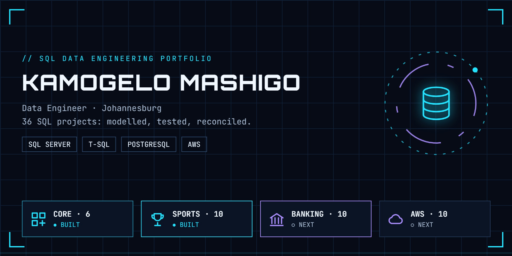
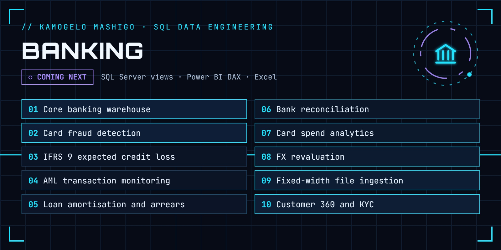
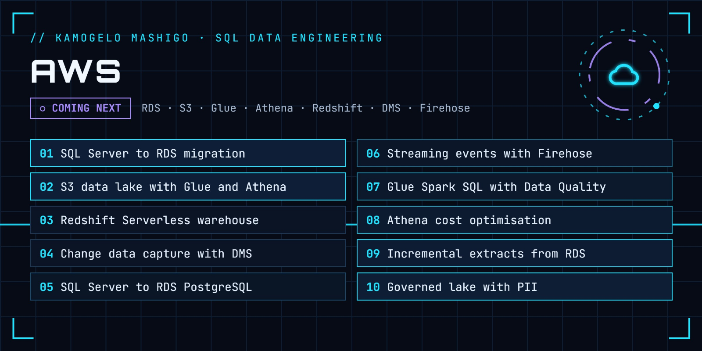
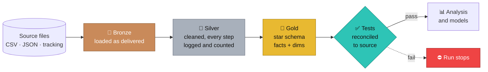

<a id="top"></a>

<p align="center">
  
</p>

<p align="center">
  
  
  
  
</p>

<p align="center">
  
  
  
  
  
  
</p>

<p align="center">
  <b>Data Engineer · Johannesburg</b><br>
  36 SQL projects, each one modelled, tested and reconciled against its source.
</p>

<p align="center">
  <a href="#how-i-work">How I Work</a> ·
  <a href="#core">Core</a> ·
  <a href="#sports">Sports</a> ·
  <a href="#banking">Banking</a> ·
  <a href="#aws">AWS</a> ·
  <a href="#run-it-yourself">Run It</a> ·
  <a href="#how-its-tested">Testing</a> ·
  <a href="#lets-talk">Contact</a>
</p>

---

## 👋 About

Hi, I'm Kamogelo, a **Data Engineer** in Johannesburg with qualifications in Computer Science and Systems Engineering. This portfolio has **36 SQL projects** across four tracks. **16 are built and tested**: Core (6) and Sports (10), all on SQL Server. Banking and AWS (20 projects) come next.

<table>
  <tr>
    <td width="50%" align="center">
      <a href="core"></a><br>
      <b>Core</b> · 6 projects · ✅ built and tested
    </td>
    <td width="50%" align="center">
      <a href="sports"></a><br>
      <b>Sports</b> · 10 projects · ✅ built and tested
    </td>
  </tr>
  <tr>
    <td width="50%" align="center">
      <br>
      <b>Banking</b> · 10 projects · ⏳ coming next
    </td>
    <td width="50%" align="center">
      <br>
      <b>AWS</b> · 10 projects · ⏳ coming next
    </td>
  </tr>
</table>

<p align="center"><sub>Click Core or Sports to open its folder. Banking and AWS are coming next.</sub></p>

---

## 🛠️ How I Work

Every project runs through the same layered pipeline, and the run stops at the first failed test.



| Principle | What it means |
| --- | --- |
| 📐 **Model first** | The design and the grain of every table (one row = what?) are written down before any query. |
| 🧱 **Layered pipelines** | Bronze (as delivered) → Silver (cleaned and logged) → Gold (modelled). |
| ⭐ **Star schemas** | Facts hold keys and measures; descriptions live in dimensions. |
| 🧮 **Prove the numbers** | Row counts, null and orphan key checks, duplicate checks and totals reconciled against the source. |
| 🏷️ **Clear naming** | `stg_` staging · `dim_` dimensions · `fact_` facts · `vw_` views |
| 📦 **Built to hand over** | Every project has a README, a data dictionary and its grain written down. Full rules in [DATA_ENGINEERING_STANDARDS.md](DATA_ENGINEERING_STANDARDS.md). |

---

<a id="core"></a>

## ✅ Core

<a href="core"></a>

My six original SQL Server projects, rebuilt in 2026 to the standards above. · [Open folder →](core)

| # | Project | Data | What it shows |
| :-: | --- | --- | --- |
| 01 | [**UEFA Champions League warehouse**](core/01_ucl_champions_league) | Real CSV | Four flat extracts to a star schema; grain checks; player similarity |
| 02 | [**European top-5 leagues pipeline**](core/02_european_top5_leagues) | 15 real CSV files | Raw, staging, clean and model layers; quarantine; Elo match model |
| 03 | [**SCD Type 2 customer history**](core/03_scd_type2_customer_history) | Generated | Type 0, 1 and 2 per column; `MERGE` with `OUTPUT`; point-in-time joins |
| 04 | [**Data quality framework**](core/04_data_quality_framework) | Generated, 56 known defects | Rules as data; safe dynamic SQL; quarantine; testing the tester |
| 05 | [**Query performance tuning**](core/05_query_performance_tuning) | 2 million generated orders | Seven slow queries measured, tuned and proven equivalent |
| 06 | [**Customer analytics**](core/06_customer_analytics) | Generated | RFM, cohorts, basket analysis, `GROUPING SETS`, churn model |

<a id="sports"></a>

## ✅ Sports

<a href="sports"></a>

Real public sports data, from every World Cup match since 1930 to the 2023 Formula 1 season. · [Open folder →](sports)

| # | Project | Data | What it shows |
| :-: | --- | --- | --- |
| 01 | [**World Cup data warehouse**](sports/01_world_cup_warehouse) | Every match since 1930 | Medallion layers, audit trail, match-outcome model |
| 02 | [**NBA Elo history**](sports/02_nba_elo_history) | 1946 to 2015 | Mirrored-row de-duplication, SCD2 franchises, win probability |
| 03 | [**Five leagues JSON pipeline**](sports/03_five_leagues_json_pipeline) | JSON | `OPENJSON`, team-name matching, Poisson score model |
| 04 | [**NBA player impact**](sports/04_nba_player_impact) | CSV | Sample-size rules, unpivot, z-scores, similarity search |
| 05 | [**Fantasy football points engine**](sports/05_fantasy_points_engine) | CSV | A rules engine that reproduces published points exactly |
| 06 | [**Boston Marathon 2016**](sports/06_marathon_results) | CSV | Time parsing, missing timing mats, anomaly detection |
| 07 | [**Premier League transfer market**](sports/07_transfer_market) | CSV | Fee parsing, learned club aliases, two-sided transfers |
| 08 | [**Match tracking data**](sports/08_match_tracking_data) | 5 Hz tracking CSV | Multi-row headers, speeds, sprints, possession inference |
| 09 | [**Formula 1 2023 season**](sports/09_formula1_season) | CSV | Conformed dimensions, points engine, title clinch |
| 10 | [**Olympic medal table**](sports/10_olympic_medal_table) | 1992 to 2016 | Grain fix for team events, reference reconciliation, forecast |

<a id="banking"></a>

## ⏳ Banking


Each project will also have a **measure layer**: business measures defined once and delivered as SQL Server views, Power BI DAX measures and an Excel workbook, with checks that all three agree.

<details>
<summary><b>Show the 10 banking projects</b></summary>
<br>

| # | Project | What it will show | Status |
| :-: | --- | --- | :-: |
| 01 | **Core banking warehouse** | SA ID validation, SCD2 from a change feed, balances to the cent | Planned |
| 02 | **Card fraud detection** | Time zones, FX gaps, reversals, late labels, learned scoring weights | Planned |
| 03 | **IFRS 9 expected credit loss** | WOE / IV scorecard, calibration, staging, three scenarios | Planned |
| 04 | **AML transaction monitoring** | Five scenarios, including a recursive circular-flow search | Planned |
| 05 | **Loan amortisation and arrears** | Recursive schedules, rate changes, arrears buckets | Planned |
| 06 | **Bank reconciliation** | Multi-pass matching, transposition detection, zero difference | Planned |
| 07 | **Card spend analytics** | Merchant cleaning rules, categories, subscription detection | Planned |
| 08 | **FX revaluation** | Fill-forward, cross rates, weighted average cost, P&L identity | Planned |
| 09 | **Fixed-width file ingestion** | Layout tables, overpunch decoding, batch controls, duplicate files | Planned |
| 10 | **Customer 360 and KYC** | Weighted record linkage, golden record, KYC status | Planned |

</details>

<a id="aws"></a>

## ⏳ AWS


SQL in the cloud: migrations, a lake on S3, Redshift, change data capture and streaming.

<details>
<summary><b>Show the 10 AWS projects</b></summary>
<br>

| # | Project | Services | What it will show | Status |
| :-: | --- | --- | --- | :-: |
| 01 | **SQL Server to RDS migration** | RDS SQL Server, S3, IAM | Native backup and restore, checksum validation | Planned |
| 02 | **S3 data lake with Glue and Athena** | S3, Glue Catalog, Athena | CSV, nested JSON, Parquet, Iceberg `MERGE` | Planned |
| 03 | **Redshift Serverless warehouse** | Redshift Serverless, S3 | `COPY` from CSV, Parquet and JSON; distribution and sort keys | Planned |
| 04 | **Change data capture with DMS** | DMS, RDS PostgreSQL, Athena | Insert, update and delete files to current state | Planned |
| 05 | **SQL Server to RDS PostgreSQL** | RDS PostgreSQL | Type mapping, code conversion, control totals | Planned |
| 06 | **Streaming events with Firehose** | Firehose, S3, Athena | Duplicates, late arrivals, schema changes, broken records | Planned |
| 07 | **Glue Spark SQL with Data Quality** | Glue, Glue Data Quality | Spark SQL transforms, DQDL rules, quarantine | Planned |
| 08 | **Athena cost optimisation** | Athena, S3 | Five storage layouts, bytes scanned per question | Planned |
| 09 | **Incremental extracts from RDS** | RDS PostgreSQL, Athena | Watermarks, overlap windows, reconciliation | Planned |
| 10 | **Governed lake with PII** | S3, IAM, Athena | Pseudonymisation, k-anonymity, analyst role | Planned |

</details>

---

<a id="run-it-yourself"></a>

## ▶️ Run It Yourself

> **You need:** SQL Server 2019 or later (Express is enough) and SSMS.

1. Clone the repo to a path without spaces, for example `C:\SQL_Boulevard`.
2. Open the project's `run_all.sql`, switch on **Query › SQLCMD Mode**, and check `RepoPath` and `DataPath` at the top (no quotes).
3. Execute. The run stops at the first error or failed test.

```sql
:setvar RepoPath C:\SQL_Boulevard\sports\01_world_cup_warehouse
:setvar DataPath C:\SQL_Boulevard\sports\01_world_cup_warehouse\data\raw
```

> [!TIP]
> The SQL Server service reads the data files, so use a folder it can open. `C:\SQL_Boulevard` works; your user profile or OneDrive usually does not.

<a id="how-its-tested"></a>

## 🧪 How It's Tested

| Projects | How |
| --- | --- |
| **Sports** | Every script is parsed as T-SQL, translated to PostgreSQL and run end to end, including all tests. |
| **Core** | Syntax-checked and the file loads run. They use SQL Server-only features (procedures, temp tables, partitioning, plan cache), so `run_all.sql` in SSMS is their full test. |

## 🗂️ Repository Layout

```
├── core/        6 original SQL Server projects        ✅ built
├── sports/      10 SQL Server projects on sports data ✅ built
├── assets/      banners
├── DATA_ENGINEERING_STANDARDS.md
└── LICENSE
```

## 📄 Data Notice

Sports projects and the two football Core projects use real public datasets. The other Core projects use generated data, and Banking will use synthetic data only. No real customer data is used. Code is under the MIT licence; each dataset keeps its own licence, given in its project README.

---

<a id="lets-talk"></a>

## 🤝 Let's Talk

I'm looking for **Data Engineer roles in Johannesburg or remote**. I'd love to walk you through any of these projects.

<p>
  <a href="https://github.com/masegoleroux-commits"></a>
  <a href="#"></a>
  <a href="#"></a>
  <a href="#"></a>
</p>

More of my work (AWS cloud engineering, Azure, web development and algorithms) is on my [GitHub profile](https://github.com/masegoleroux-commits).

<p align="right"><a href="#top">↑ Back to top</a></p>
