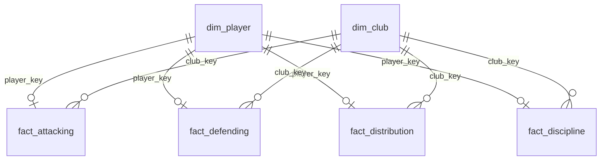

<p align="center">
  
</p>

# UEFA Champions League Warehouse

<p align="center">
  <b>Turning four flat UEFA Champions League 2021/22 CSV extracts into a tested star schema in SQL Server.</b><br>
  T-SQL · Star Schema Design · Data Quality Testing · Query Tuning
</p>

---

## Contents

- [Why this repo exists](#why-this-repo-exists)
- [The data](#the-data)
- [Model](#model)
- [Repository structure](#repository-structure)
- [How to run it](#how-to-run-it)
- [Testing](#testing)
- [Data quality findings](#data-quality-findings)
- [Analysis](#analysis)
- [Screenshots](#screenshots)
- [Results](#results)
- [Contact](#contact)

---

## Why this repo exists

Most reporting projects fail at the data layer, not the visual layer. Earlier versions of this repo were a set of ad-hoc queries run straight against imported spreadsheets (`attacking$`, `defending$`). They mostly ran, but they hid real problems: swapped columns, a percentage that didn't match its own counts, a few queries that wouldn't compile, and ratios averaged in ways that weighted a one-game cameo the same as a full season.

This version goes the other way: model first, validate the grain, enforce the constraints, and only then write the reporting queries.

## The data

Player-level statistics for the 2021/22 UEFA Champions League from the [UCL Matches & Players dataset on Kaggle](https://www.kaggle.com/datasets/azminetoushikwasi/ucl-202122-uefa-champions-league).

| File | Rows | Covers |
|---|---|---|
| `attacking.csv` | 176 | Assists, dribbles, offsides, corners (players with at least one assist) |
| `defending.csv` | 627 | Balls recovered, tackles won and lost, clearances |
| `distribution.csv` | 608 | Passes and crosses attempted and completed, free kicks |
| `disciplinary.csv` | 584 | Fouls committed and suffered, cards, minutes played |

All four together describe **704 player-club stints across 32 clubs**.

<p align="center">
  <b>Attacking</b><br>
  
</p>

<p align="center">
  <b>Defending</b><br>
  
</p>

<p align="center">
  <b>Distribution</b><br>
  
</p>

<p align="center">
  <b>Discipline</b><br>
  
</p>

## Model

A star schema with two conformed dimensions and four fact tables at the same grain.



**Grain:** one row per player per club for the 2021/22 season. The source has no player ID, and names repeat (`Martínez` plays for Ajax, Inter and Leipzig) while some players moved mid-season (Luis Díaz: Porto → Liverpool). Name + club is the narrowest key the data supports. Full reasoning is in [docs/grain.md](docs/grain.md).

**Design decisions**

- **Surrogate keys** on both dimensions, so facts never join on text.
- **Type 1 dimensions** loaded with `MERGE`. A changed attribute overwrites the old value, and existing keys are never reissued.
- **Only additive counts in the facts.** Ratios such as tackle success and pass completion are calculated in views from summed counts, so club and position roll-ups stay correctly weighted.
- **Constraints do the policing.** Primary keys enforce the grain, foreign keys stop orphans, and `CHECK` constraints reject impossible rows (for example `tackles = tackles_won + tackles_lost`, and completed passes never above attempted).
- **Covering indexes** on `club_key` with the measures each club query reads in `INCLUDE`, so club roll-ups avoid key lookups.
- **No fan-out.** `vw_club_season` aggregates each fact to club level before joining. Joining four player-level facts and then grouping would multiply rows.

ERD and load flow: [docs/erd.md](docs/erd.md) · Column definitions: [docs/data_dictionary.md](docs/data_dictionary.md)

## Repository structure

```
├── data/
│   └── raw/                      # Source CSVs, unchanged
├── ddl/
│   ├── 01_create_database.sql
│   ├── 02_staging_tables.sql     # stg_  : mirrors the CSVs
│   ├── 03_dimensions.sql         # dim_  : club, player
│   ├── 04_facts.sql              # fact_ : attacking, defending, distribution, discipline
│   ├── 05_indexes.sql
│   └── 06_views.sql              # vw_player_season, vw_club_season
├── transformations/
│   ├── 01_load_staging.sql       # BULK INSERT from data/raw
│   ├── 02_load_dimensions.sql    # MERGE into dimensions
│   └── 03_load_facts.sql         # key lookup + load, one transaction
├── tests/
│   ├── 01_grain_checks.sql
│   ├── 02_referential_integrity.sql
│   └── 03_reconciliation.sql
├── analysis/                     # Reporting queries against the model
│   ├── attacking.sql
│   ├── defending.sql
│   ├── distribution.sql
│   ├── discipline.sql
│   └── cross_domain.sql
├── docs/                         # Grain, ERD, data dictionary, data quality
├── screenshots/                  # Images used in this README
├── run_all.sql                   # Builds, loads and tests everything
└── README.md
```

## How to run it

Requires SQL Server 2017 or later (for `BULK INSERT ... FORMAT = 'CSV'`).

1. Clone the repo to a path without spaces, for example `C:\SQL_Boulevard`.
2. Open `core/01_ucl_champions_league/run_all.sql` in SSMS and turn on **Query → SQLCMD Mode**.
3. Check `RepoPath` and `DataPath` at the top (written without quotes) and execute.

Or from the command line, after checking the two paths in the file:

```bash
sqlcmd -S localhost -E -i run_all.sql
```

To run the steps one at a time instead, execute the files in `ddl/`, `transformations/` and `tests/` in numbered order.

## Testing

Three test scripts. Each returns one row per check with `PASS`, `FAIL` or `WARN`.

| Script | What it proves |
|---|---|
| `01_grain_checks.sql` | No duplicate natural keys in staging or dimensions. One fact row per player. Position and matches played agree across files. Views return exactly one row per dimension member. |
| `02_referential_integrity.sql` | No orphaned foreign keys. Each fact's `club_key` matches the player's club. No staging row was dropped by a failed key lookup. |
| `03_reconciliation.sql` | Row counts and control totals (assists, tackles, passes, fouls, minutes, cards) match between staging and facts. Source business rules hold. |

**Current result:** 41 checks. 40 pass, and 1 warns on a known source issue (below).

## Data quality findings

Profiling turned up two real problems in the source. Both are handled in the model rather than ignored. Details are in [docs/data_quality.md](docs/data_quality.md).

1. **Red and yellow cards are swapped** in `disciplinary.csv`. The file shows 492 red cards and 25 yellows for the season, and one player with four reds in 13 games. The load maps them the right way round, and reconciliation checks each column against its true source.
2. **`pass_accuracy` doesn't match the pass counts** for 311 of 608 rows (82 by more than five points). Completion rates are recalculated from the counts. The source value is kept as `pass_accuracy_src` for reference only.

## Analysis

44 queries in [`analysis/`](analysis/), all written against the model. A few examples of what changed from the original versions:

| Before | After |
|---|---|
| Fouls per minute with no minimum, so a few minutes off the bench topped the list | Fouls per 90 minutes, with a 270-minute minimum |
| `AVG(balls_recoverd / match_played)` by club, which averaged per-player ratios | `SUM(balls_recovered) / SUM(matches_played)`, weighted by volume |
| Pass accuracy leaders with no minimum, so a handful of passes could top the list | Minimum 100 passes, rate calculated from counts |
| `GROUP BY player_name` while selecting `club`, which failed to compile | Grouping on the surrogate key through the dimension |
| `HAVING UniquePositionsPlayed > 1`, which referenced an alias and failed to compile | Removed. Position is a single attribute per player-club, as the grain test confirms |

Cross-domain questions, such as whether the best dribblers draw the most fouls or which ball-winners also keep possession, run against `vw_player_season` and need no extra joins.

## Screenshots


### Entity relationship diagram
*The six model tables and their keys.*

<!--
<p align="center">
  
</p>
-->

### Load output
*Row counts returned at the end of `transformations/03_load_facts.sql`.*

<!--
<p align="center">
  
</p>
-->

### Test results
*Results grid from `tests/03_reconciliation.sql` showing PASS / WARN.*

<!--
<p align="center">
  
</p>
-->

### Execution plan
*Actual execution plan for a club roll-up (e.g. query 6 in `analysis/attacking.sql`) showing an index seek or scan on `ix_fact_attacking_club` with no key lookup.*

<!--
<p align="center">
  
</p>
-->

### Analysis results
*One results grid from each analysis script.*

<!--
<p align="center">
  
</p>
<p align="center">
  
</p>
<p align="center">
  
</p>
<p align="center">
  
</p>
-->

## Results

| | |
|---|---|
| Source rows loaded | 1,995 across 4 files |
| Model | 2 dimensions, 4 facts, 2 views |
| Dimension members | 704 players, 32 clubs |
| Rows lost or duplicated in load | 0 (reconciled on counts and 10 control totals) |
| Automated checks | 41 (40 pass, 1 known-issue warning) |
| Source defects found and corrected | 2 |

<!--
Performance (fill in from SSMS: SET STATISTICS TIME ON / IO ON)
| Metric | Before (flat tables) | After (star schema) |
|---|---|---|
| Club roll-up logical reads | | |
| Club roll-up elapsed time (ms) | | |
| Full rebuild time (run_all.sql) | | |
-->

## Contact

[GitHub](https://github.com/MasegoLeRoux)
<!-- Add LinkedIn: [LinkedIn](https://www.linkedin.com/in/your-handle/) -->

## License

[MIT](../../LICENSE)

---

[← Back to Core projects](../README.md) · [Portfolio home](../../README.md)
