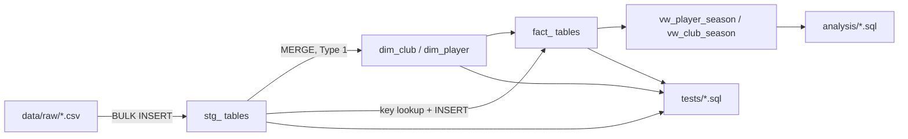

# Entity Relationship Diagram

GitHub renders the diagram below directly. For an exported image, see `screenshots/erd.png`.

```drawio
<mxfile>
  <diagram id="8Ts-PoeJobXF_4GqAuRm" name="Page-1">
    <mxGraphModel dx="1479" dy="1877" grid="1" gridSize="10" guides="1" tooltips="0" connect="1" arrows="1" fold="1" page="1" pageScale="1" pageWidth="850" pageHeight="1100" math="0" shadow="0">
      <root>
        <mxCell id="pR_t8XFKPIlkEiZwQIF_-0" />
        <mxCell id="pR_t8XFKPIlkEiZwQIF_-1" parent="pR_t8XFKPIlkEiZwQIF_-0" />
        <UserObject label="" mermaidData="{&#xa;  &quot;data&quot;: &quot;erDiagram\n    dim_club ||--o{ fact_attacking    : \&quot;club_key\&quot;\n    dim_club ||--o{ fact_defending    : \&quot;club_key\&quot;\n    dim_club ||--o{ fact_distribution : \&quot;club_key\&quot;\n    dim_club ||--o{ fact_discipline   : \&quot;club_key\&quot;\n\n    dim_player ||--o| fact_attacking    : \&quot;player_key\&quot;\n    dim_player ||--o| fact_defending    : \&quot;player_key\&quot;\n    dim_player ||--o| fact_distribution : \&quot;player_key\&quot;\n    dim_player ||--o| fact_discipline   : \&quot;player_key\&quot;\n\n    dim_club {\n        int club_key PK\n        nvarchar club_name UK\n    }\n    dim_player {\n        int player_key PK\n        nvarchar player_name UK\n        nvarchar club_name UK\n        nvarchar position\n    }\n    fact_attacking {\n        int player_key PK, FK\n        int club_key FK\n        int matches_played\n        int assists\n        int corners_taken\n        int offsides\n        int dribbles\n    }\n    fact_defending {\n        int player_key PK, FK\n        int club_key FK\n        int matches_played\n        int balls_recovered\n        int tackles\n        int tackles_won\n        int tackles_lost\n        int clearances_attempted\n    }\n    fact_distribution {\n        int player_key PK, FK\n        int club_key FK\n        int matches_played\n        int passes_attempted\n        int passes_completed\n        int crosses_attempted\n        int crosses_completed\n        int free_kicks_taken\n        decimal pass_accuracy_src\n    }\n    fact_discipline {\n        int player_key PK, FK\n        int club_key FK\n        int matches_played\n        int minutes_played\n        int fouls_committed\n        int fouls_suffered\n        int yellow_cards\n        int red_cards\n    }&quot;,&#xa;  &quot;config&quot;: null&#xa;}" id="mM_FCJiMSByYyIrZ1bdv-0">
          <mxCell connectable="0" parent="pR_t8XFKPIlkEiZwQIF_-1" style="group;transparentBounds=1;editIcon=1;lockedGroup=0;groupPadding=10;rounded=1;roundedPerimeter=1;sketch=1;curveFitting=1;jiggle=2;" vertex="1">
            <mxGeometry as="geometry" />
          </mxCell>
        </UserObject>
        <UserObject label="dim_club" mermaidId="n:dim_club" mermaidBaseStyle="shape=table;startSize=43;container=1;collapsible=0;childLayout=tableLayout;fixedRows=1;rowLines=1;fontSize=16;fontFamily=Trebuchet MS,Verdana,Arial,sans-serif;strokeWidth=1;align=center;resizeLast=1;html=1;fillColor=light-dark(#ECECFF,#1f2020);strokeColor=light-dark(#9370DB,#cccccc);fontColor=light-dark(#333333,#cccccc);" mermaidBaseValue="dim_club" id="pR_t8XFKPIlkEiZwQIF_-2">
          <mxCell parent="mM_FCJiMSByYyIrZ1bdv-0" style="shape=table;startSize=43;container=1;collapsible=0;childLayout=tableLayout;fixedRows=1;rowLines=1;fontSize=16;fontFamily=Trebuchet MS,Verdana,Arial,sans-serif;strokeWidth=1;align=center;resizeLast=1;html=1;fillColor=light-dark(#ECECFF,#1f2020);strokeColor=light-dark(#9370DB,#cccccc);fontColor=light-dark(#333333,#cccccc);rounded=1;roundedPerimeter=1;sketch=1;curveFitting=1;jiggle=2;" vertex="1">
            <mxGeometry height="129" width="236" x="429" y="53" as="geometry" />
          </mxCell>
        </UserObject>
        <mxCell id="pR_t8XFKPIlkEiZwQIF_-3" parent="pR_t8XFKPIlkEiZwQIF_-2" style="shape=tableRow;horizontal=0;startSize=0;swimlaneHead=0;swimlaneBody=1;fillColor=light-dark(#ffffff,#1f2020);strokeColor=inherit;strokeWidth=1;collapsible=0;dropTarget=0;points=[[0,0.5],[1,0.5]];portConstraint=eastwest;top=0;left=0;right=0;bottom=0;rounded=1;roundedPerimeter=1;sketch=1;curveFitting=1;jiggle=2;" vertex="1">
          <mxGeometry height="43" width="236" y="43" as="geometry" />
        </mxCell>
        <mxCell id="pR_t8XFKPIlkEiZwQIF_-4" parent="pR_t8XFKPIlkEiZwQIF_-3" style="shape=partialRectangle;connectable=0;fillColor=none;strokeColor=light-dark(#9370DB,#cccccc);strokeWidth=1;fontColor=light-dark(#333333,#cccccc);fontFamily=Trebuchet MS,Verdana,Arial,sans-serif;top=1;left=1;bottom=1;right=1;align=left;spacingLeft=8;overflow=hidden;fontSize=16;rounded=1;roundedPerimeter=1;sketch=1;curveFitting=1;jiggle=2;" value="int" vertex="1">
          <mxGeometry height="43" width="88" as="geometry">
            <mxRectangle height="43" width="88" as="alternateBounds" />
          </mxGeometry>
        </mxCell>
        <mxCell id="pR_t8XFKPIlkEiZwQIF_-5" parent="pR_t8XFKPIlkEiZwQIF_-3" style="shape=partialRectangle;connectable=0;fillColor=none;strokeColor=light-dark(#9370DB,#cccccc);strokeWidth=1;fontColor=light-dark(#333333,#cccccc);fontFamily=Trebuchet MS,Verdana,Arial,sans-serif;top=1;left=1;bottom=1;right=1;align=left;spacingLeft=8;overflow=hidden;fontSize=16;rounded=1;roundedPerimeter=1;sketch=1;curveFitting=1;jiggle=2;" value="club_key" vertex="1">
          <mxGeometry height="43" width="103" x="88" as="geometry">
            <mxRectangle height="43" width="103" as="alternateBounds" />
          </mxGeometry>
        </mxCell>
        <mxCell id="pR_t8XFKPIlkEiZwQIF_-6" parent="pR_t8XFKPIlkEiZwQIF_-3" style="shape=partialRectangle;connectable=0;fillColor=none;strokeColor=light-dark(#9370DB,#cccccc);strokeWidth=1;fontColor=light-dark(#333333,#cccccc);fontFamily=Trebuchet MS,Verdana,Arial,sans-serif;top=1;left=1;bottom=1;right=1;align=left;spacingLeft=8;overflow=hidden;fontSize=16;rounded=1;roundedPerimeter=1;sketch=1;curveFitting=1;jiggle=2;" value="PK" vertex="1">
          <mxGeometry height="43" width="45" x="191" as="geometry">
            <mxRectangle height="43" width="45" as="alternateBounds" />
          </mxGeometry>
        </mxCell>
        <mxCell id="pR_t8XFKPIlkEiZwQIF_-7" parent="pR_t8XFKPIlkEiZwQIF_-2" style="shape=tableRow;horizontal=0;startSize=0;swimlaneHead=0;swimlaneBody=1;fillColor=light-dark(#F1F1FF,#1f2020);strokeColor=inherit;strokeWidth=1;collapsible=0;dropTarget=0;points=[[0,0.5],[1,0.5]];portConstraint=eastwest;top=0;left=0;right=0;bottom=0;rounded=1;roundedPerimeter=1;sketch=1;curveFitting=1;jiggle=2;" vertex="1">
          <mxGeometry height="43" width="236" y="86" as="geometry" />
        </mxCell>
        <mxCell id="pR_t8XFKPIlkEiZwQIF_-8" parent="pR_t8XFKPIlkEiZwQIF_-7" style="shape=partialRectangle;connectable=0;fillColor=none;strokeColor=light-dark(#9370DB,#cccccc);strokeWidth=1;fontColor=light-dark(#333333,#cccccc);fontFamily=Trebuchet MS,Verdana,Arial,sans-serif;top=1;left=1;bottom=1;right=1;align=left;spacingLeft=8;overflow=hidden;fontSize=16;rounded=1;roundedPerimeter=1;sketch=1;curveFitting=1;jiggle=2;" value="nvarchar" vertex="1">
          <mxGeometry height="43" width="88" as="geometry">
            <mxRectangle height="43" width="88" as="alternateBounds" />
          </mxGeometry>
        </mxCell>
        <mxCell id="pR_t8XFKPIlkEiZwQIF_-9" parent="pR_t8XFKPIlkEiZwQIF_-7" style="shape=partialRectangle;connectable=0;fillColor=none;strokeColor=light-dark(#9370DB,#cccccc);strokeWidth=1;fontColor=light-dark(#333333,#cccccc);fontFamily=Trebuchet MS,Verdana,Arial,sans-serif;top=1;left=1;bottom=1;right=1;align=left;spacingLeft=8;overflow=hidden;fontSize=16;rounded=1;roundedPerimeter=1;sketch=1;curveFitting=1;jiggle=2;" value="club_name" vertex="1">
          <mxGeometry height="43" width="103" x="88" as="geometry">
            <mxRectangle height="43" width="103" as="alternateBounds" />
          </mxGeometry>
        </mxCell>
        <mxCell id="pR_t8XFKPIlkEiZwQIF_-10" parent="pR_t8XFKPIlkEiZwQIF_-7" style="shape=partialRectangle;connectable=0;fillColor=none;strokeColor=light-dark(#9370DB,#cccccc);strokeWidth=1;fontColor=light-dark(#333333,#cccccc);fontFamily=Trebuchet MS,Verdana,Arial,sans-serif;top=1;left=1;bottom=1;right=1;align=left;spacingLeft=8;overflow=hidden;fontSize=16;rounded=1;roundedPerimeter=1;sketch=1;curveFitting=1;jiggle=2;" value="UK" vertex="1">
          <mxGeometry height="43" width="45" x="191" as="geometry">
            <mxRectangle height="43" width="45" as="alternateBounds" />
          </mxGeometry>
        </mxCell>
        <UserObject label="fact_attacking" mermaidId="n:fact_attacking" mermaidBaseStyle="shape=table;startSize=43;container=1;collapsible=0;childLayout=tableLayout;fixedRows=1;rowLines=1;fontSize=16;fontFamily=Trebuchet MS,Verdana,Arial,sans-serif;strokeWidth=1;align=center;resizeLast=1;html=1;fillColor=light-dark(#ECECFF,#1f2020);strokeColor=light-dark(#9370DB,#cccccc);fontColor=light-dark(#333333,#cccccc);" mermaidBaseValue="fact_attacking" id="pR_t8XFKPIlkEiZwQIF_-11">
          <mxCell parent="mM_FCJiMSByYyIrZ1bdv-0" style="shape=table;startSize=43;container=1;collapsible=0;childLayout=tableLayout;fixedRows=1;rowLines=1;fontSize=16;fontFamily=Trebuchet MS,Verdana,Arial,sans-serif;strokeWidth=1;align=center;resizeLast=1;html=1;fillColor=light-dark(#ECECFF,#1f2020);strokeColor=light-dark(#9370DB,#cccccc);fontColor=light-dark(#333333,#cccccc);rounded=1;roundedPerimeter=1;sketch=1;curveFitting=1;jiggle=2;" vertex="1">
            <mxGeometry height="344" width="253" x="10" y="387" as="geometry" />
          </mxCell>
        </UserObject>
        <mxCell id="pR_t8XFKPIlkEiZwQIF_-12" parent="pR_t8XFKPIlkEiZwQIF_-11" style="shape=tableRow;horizontal=0;startSize=0;swimlaneHead=0;swimlaneBody=1;fillColor=light-dark(#ffffff,#1f2020);strokeColor=inherit;strokeWidth=1;collapsible=0;dropTarget=0;points=[[0,0.5],[1,0.5]];portConstraint=eastwest;top=0;left=0;right=0;bottom=0;rounded=1;roundedPerimeter=1;sketch=1;curveFitting=1;jiggle=2;" vertex="1">
          <mxGeometry height="43" width="253" y="43" as="geometry" />
        </mxCell>
        <mxCell id="pR_t8XFKPIlkEiZwQIF_-13" parent="pR_t8XFKPIlkEiZwQIF_-12" style="shape=partialRectangle;connectable=0;fillColor=none;strokeColor=light-dark(#9370DB,#cccccc);strokeWidth=1;fontColor=light-dark(#333333,#cccccc);fontFamily=Trebuchet MS,Verdana,Arial,sans-serif;top=1;left=1;bottom=1;right=1;align=left;spacingLeft=8;overflow=hidden;fontSize=16;rounded=1;roundedPerimeter=1;sketch=1;curveFitting=1;jiggle=2;" value="int" vertex="1">
          <mxGeometry height="43" width="45" as="geometry">
            <mxRectangle height="43" width="45" as="alternateBounds" />
          </mxGeometry>
        </mxCell>
        <mxCell id="pR_t8XFKPIlkEiZwQIF_-14" parent="pR_t8XFKPIlkEiZwQIF_-12" style="shape=partialRectangle;connectable=0;fillColor=none;strokeColor=light-dark(#9370DB,#cccccc);strokeWidth=1;fontColor=light-dark(#333333,#cccccc);fontFamily=Trebuchet MS,Verdana,Arial,sans-serif;top=1;left=1;bottom=1;right=1;align=left;spacingLeft=8;overflow=hidden;fontSize=16;rounded=1;roundedPerimeter=1;sketch=1;curveFitting=1;jiggle=2;" value="player_key" vertex="1">
          <mxGeometry height="43" width="141" x="45" as="geometry">
            <mxRectangle height="43" width="141" as="alternateBounds" />
          </mxGeometry>
        </mxCell>
        <mxCell id="pR_t8XFKPIlkEiZwQIF_-15" parent="pR_t8XFKPIlkEiZwQIF_-12" style="shape=partialRectangle;connectable=0;fillColor=none;strokeColor=light-dark(#9370DB,#cccccc);strokeWidth=1;fontColor=light-dark(#333333,#cccccc);fontFamily=Trebuchet MS,Verdana,Arial,sans-serif;top=1;left=1;bottom=1;right=1;align=left;spacingLeft=8;overflow=hidden;fontSize=16;rounded=1;roundedPerimeter=1;sketch=1;curveFitting=1;jiggle=2;" value="PK,FK" vertex="1">
          <mxGeometry height="43" width="67" x="186" as="geometry">
            <mxRectangle height="43" width="67" as="alternateBounds" />
          </mxGeometry>
        </mxCell>
        <mxCell id="pR_t8XFKPIlkEiZwQIF_-16" parent="pR_t8XFKPIlkEiZwQIF_-11" style="shape=tableRow;horizontal=0;startSize=0;swimlaneHead=0;swimlaneBody=1;fillColor=light-dark(#F1F1FF,#1f2020);strokeColor=inherit;strokeWidth=1;collapsible=0;dropTarget=0;points=[[0,0.5],[1,0.5]];portConstraint=eastwest;top=0;left=0;right=0;bottom=0;rounded=1;roundedPerimeter=1;sketch=1;curveFitting=1;jiggle=2;" vertex="1">
          <mxGeometry height="43" width="253" y="86" as="geometry" />
        </mxCell>
        <mxCell id="pR_t8XFKPIlkEiZwQIF_-17" parent="pR_t8XFKPIlkEiZwQIF_-16" style="shape=partialRectangle;connectable=0;fillColor=none;strokeColor=light-dark(#9370DB,#cccccc);strokeWidth=1;fontColor=light-dark(#333333,#cccccc);fontFamily=Trebuchet MS,Verdana,Arial,sans-serif;top=1;left=1;bottom=1;right=1;align=left;spacingLeft=8;overflow=hidden;fontSize=16;rounded=1;roundedPerimeter=1;sketch=1;curveFitting=1;jiggle=2;" value="int" vertex="1">
          <mxGeometry height="43" width="45" as="geometry">
            <mxRectangle height="43" width="45" as="alternateBounds" />
          </mxGeometry>
        </mxCell>
        <mxCell id="pR_t8XFKPIlkEiZwQIF_-18" parent="pR_t8XFKPIlkEiZwQIF_-16" style="shape=partialRectangle;connectable=0;fillColor=none;strokeColor=light-dark(#9370DB,#cccccc);strokeWidth=1;fontColor=light-dark(#333333,#cccccc);fontFamily=Trebuchet MS,Verdana,Arial,sans-serif;top=1;left=1;bottom=1;right=1;align=left;spacingLeft=8;overflow=hidden;fontSize=16;rounded=1;roundedPerimeter=1;sketch=1;curveFitting=1;jiggle=2;" value="club_key" vertex="1">
          <mxGeometry height="43" width="141" x="45" as="geometry">
            <mxRectangle height="43" width="141" as="alternateBounds" />
          </mxGeometry>
        </mxCell>
        <mxCell id="pR_t8XFKPIlkEiZwQIF_-19" parent="pR_t8XFKPIlkEiZwQIF_-16" style="shape=partialRectangle;connectable=0;fillColor=none;strokeColor=light-dark(#9370DB,#cccccc);strokeWidth=1;fontColor=light-dark(#333333,#cccccc);fontFamily=Trebuchet MS,Verdana,Arial,sans-serif;top=1;left=1;bottom=1;right=1;align=left;spacingLeft=8;overflow=hidden;fontSize=16;rounded=1;roundedPerimeter=1;sketch=1;curveFitting=1;jiggle=2;" value="FK" vertex="1">
          <mxGeometry height="43" width="67" x="186" as="geometry">
            <mxRectangle height="43" width="67" as="alternateBounds" />
          </mxGeometry>
        </mxCell>
        <mxCell id="pR_t8XFKPIlkEiZwQIF_-20" parent="pR_t8XFKPIlkEiZwQIF_-11" style="shape=tableRow;horizontal=0;startSize=0;swimlaneHead=0;swimlaneBody=1;fillColor=light-dark(#ffffff,#1f2020);strokeColor=inherit;strokeWidth=1;collapsible=0;dropTarget=0;points=[[0,0.5],[1,0.5]];portConstraint=eastwest;top=0;left=0;right=0;bottom=0;rounded=1;roundedPerimeter=1;sketch=1;curveFitting=1;jiggle=2;" vertex="1">
          <mxGeometry height="43" width="253" y="129" as="geometry" />
        </mxCell>
        <mxCell id="pR_t8XFKPIlkEiZwQIF_-21" parent="pR_t8XFKPIlkEiZwQIF_-20" style="shape=partialRectangle;connectable=0;fillColor=none;strokeColor=light-dark(#9370DB,#cccccc);strokeWidth=1;fontColor=light-dark(#333333,#cccccc);fontFamily=Trebuchet MS,Verdana,Arial,sans-serif;top=1;left=1;bottom=1;right=1;align=left;spacingLeft=8;overflow=hidden;fontSize=16;rounded=1;roundedPerimeter=1;sketch=1;curveFitting=1;jiggle=2;" value="int" vertex="1">
          <mxGeometry height="43" width="45" as="geometry">
            <mxRectangle height="43" width="45" as="alternateBounds" />
          </mxGeometry>
        </mxCell>
        <mxCell id="pR_t8XFKPIlkEiZwQIF_-22" parent="pR_t8XFKPIlkEiZwQIF_-20" style="shape=partialRectangle;connectable=0;fillColor=none;strokeColor=light-dark(#9370DB,#cccccc);strokeWidth=1;fontColor=light-dark(#333333,#cccccc);fontFamily=Trebuchet MS,Verdana,Arial,sans-serif;top=1;left=1;bottom=1;right=1;align=left;spacingLeft=8;overflow=hidden;fontSize=16;rounded=1;roundedPerimeter=1;sketch=1;curveFitting=1;jiggle=2;" value="matches_played" vertex="1">
          <mxGeometry height="43" width="141" x="45" as="geometry">
            <mxRectangle height="43" width="141" as="alternateBounds" />
          </mxGeometry>
        </mxCell>
        <mxCell id="pR_t8XFKPIlkEiZwQIF_-23" parent="pR_t8XFKPIlkEiZwQIF_-20" style="shape=partialRectangle;connectable=0;fillColor=none;strokeColor=light-dark(#9370DB,#cccccc);strokeWidth=1;fontColor=light-dark(#333333,#cccccc);fontFamily=Trebuchet MS,Verdana,Arial,sans-serif;top=1;left=1;bottom=1;right=1;align=left;spacingLeft=8;overflow=hidden;fontSize=16;rounded=1;roundedPerimeter=1;sketch=1;curveFitting=1;jiggle=2;" value="" vertex="1">
          <mxGeometry height="43" width="67" x="186" as="geometry">
            <mxRectangle height="43" width="67" as="alternateBounds" />
          </mxGeometry>
        </mxCell>
        <mxCell id="pR_t8XFKPIlkEiZwQIF_-24" parent="pR_t8XFKPIlkEiZwQIF_-11" style="shape=tableRow;horizontal=0;startSize=0;swimlaneHead=0;swimlaneBody=1;fillColor=light-dark(#F1F1FF,#1f2020);strokeColor=inherit;strokeWidth=1;collapsible=0;dropTarget=0;points=[[0,0.5],[1,0.5]];portConstraint=eastwest;top=0;left=0;right=0;bottom=0;rounded=1;roundedPerimeter=1;sketch=1;curveFitting=1;jiggle=2;" vertex="1">
          <mxGeometry height="43" width="253" y="172" as="geometry" />
        </mxCell>
        <mxCell id="pR_t8XFKPIlkEiZwQIF_-25" parent="pR_t8XFKPIlkEiZwQIF_-24" style="shape=partialRectangle;connectable=0;fillColor=none;strokeColor=light-dark(#9370DB,#cccccc);strokeWidth=1;fontColor=light-dark(#333333,#cccccc);fontFamily=Trebuchet MS,Verdana,Arial,sans-serif;top=1;left=1;bottom=1;right=1;align=left;spacingLeft=8;overflow=hidden;fontSize=16;rounded=1;roundedPerimeter=1;sketch=1;curveFitting=1;jiggle=2;" value="int" vertex="1">
          <mxGeometry height="43" width="45" as="geometry">
            <mxRectangle height="43" width="45" as="alternateBounds" />
          </mxGeometry>
        </mxCell>
        <mxCell id="pR_t8XFKPIlkEiZwQIF_-26" parent="pR_t8XFKPIlkEiZwQIF_-24" style="shape=partialRectangle;connectable=0;fillColor=none;strokeColor=light-dark(#9370DB,#cccccc);strokeWidth=1;fontColor=light-dark(#333333,#cccccc);fontFamily=Trebuchet MS,Verdana,Arial,sans-serif;top=1;left=1;bottom=1;right=1;align=left;spacingLeft=8;overflow=hidden;fontSize=16;rounded=1;roundedPerimeter=1;sketch=1;curveFitting=1;jiggle=2;" value="assists" vertex="1">
          <mxGeometry height="43" width="141" x="45" as="geometry">
            <mxRectangle height="43" width="141" as="alternateBounds" />
          </mxGeometry>
        </mxCell>
        <mxCell id="pR_t8XFKPIlkEiZwQIF_-27" parent="pR_t8XFKPIlkEiZwQIF_-24" style="shape=partialRectangle;connectable=0;fillColor=none;strokeColor=light-dark(#9370DB,#cccccc);strokeWidth=1;fontColor=light-dark(#333333,#cccccc);fontFamily=Trebuchet MS,Verdana,Arial,sans-serif;top=1;left=1;bottom=1;right=1;align=left;spacingLeft=8;overflow=hidden;fontSize=16;rounded=1;roundedPerimeter=1;sketch=1;curveFitting=1;jiggle=2;" value="" vertex="1">
          <mxGeometry height="43" width="67" x="186" as="geometry">
            <mxRectangle height="43" width="67" as="alternateBounds" />
          </mxGeometry>
        </mxCell>
        <mxCell id="pR_t8XFKPIlkEiZwQIF_-28" parent="pR_t8XFKPIlkEiZwQIF_-11" style="shape=tableRow;horizontal=0;startSize=0;swimlaneHead=0;swimlaneBody=1;fillColor=light-dark(#ffffff,#1f2020);strokeColor=inherit;strokeWidth=1;collapsible=0;dropTarget=0;points=[[0,0.5],[1,0.5]];portConstraint=eastwest;top=0;left=0;right=0;bottom=0;rounded=1;roundedPerimeter=1;sketch=1;curveFitting=1;jiggle=2;" vertex="1">
          <mxGeometry height="43" width="253" y="215" as="geometry" />
        </mxCell>
        <mxCell id="pR_t8XFKPIlkEiZwQIF_-29" parent="pR_t8XFKPIlkEiZwQIF_-28" style="shape=partialRectangle;connectable=0;fillColor=none;strokeColor=light-dark(#9370DB,#cccccc);strokeWidth=1;fontColor=light-dark(#333333,#cccccc);fontFamily=Trebuchet MS,Verdana,Arial,sans-serif;top=1;left=1;bottom=1;right=1;align=left;spacingLeft=8;overflow=hidden;fontSize=16;rounded=1;roundedPerimeter=1;sketch=1;curveFitting=1;jiggle=2;" value="int" vertex="1">
          <mxGeometry height="43" width="45" as="geometry">
            <mxRectangle height="43" width="45" as="alternateBounds" />
          </mxGeometry>
        </mxCell>
        <mxCell id="pR_t8XFKPIlkEiZwQIF_-30" parent="pR_t8XFKPIlkEiZwQIF_-28" style="shape=partialRectangle;connectable=0;fillColor=none;strokeColor=light-dark(#9370DB,#cccccc);strokeWidth=1;fontColor=light-dark(#333333,#cccccc);fontFamily=Trebuchet MS,Verdana,Arial,sans-serif;top=1;left=1;bottom=1;right=1;align=left;spacingLeft=8;overflow=hidden;fontSize=16;rounded=1;roundedPerimeter=1;sketch=1;curveFitting=1;jiggle=2;" value="corners_taken" vertex="1">
          <mxGeometry height="43" width="141" x="45" as="geometry">
            <mxRectangle height="43" width="141" as="alternateBounds" />
          </mxGeometry>
        </mxCell>
        <mxCell id="pR_t8XFKPIlkEiZwQIF_-31" parent="pR_t8XFKPIlkEiZwQIF_-28" style="shape=partialRectangle;connectable=0;fillColor=none;strokeColor=light-dark(#9370DB,#cccccc);strokeWidth=1;fontColor=light-dark(#333333,#cccccc);fontFamily=Trebuchet MS,Verdana,Arial,sans-serif;top=1;left=1;bottom=1;right=1;align=left;spacingLeft=8;overflow=hidden;fontSize=16;rounded=1;roundedPerimeter=1;sketch=1;curveFitting=1;jiggle=2;" value="" vertex="1">
          <mxGeometry height="43" width="67" x="186" as="geometry">
            <mxRectangle height="43" width="67" as="alternateBounds" />
          </mxGeometry>
        </mxCell>
        <mxCell id="pR_t8XFKPIlkEiZwQIF_-32" parent="pR_t8XFKPIlkEiZwQIF_-11" style="shape=tableRow;horizontal=0;startSize=0;swimlaneHead=0;swimlaneBody=1;fillColor=light-dark(#F1F1FF,#1f2020);strokeColor=inherit;strokeWidth=1;collapsible=0;dropTarget=0;points=[[0,0.5],[1,0.5]];portConstraint=eastwest;top=0;left=0;right=0;bottom=0;rounded=1;roundedPerimeter=1;sketch=1;curveFitting=1;jiggle=2;" vertex="1">
          <mxGeometry height="43" width="253" y="258" as="geometry" />
        </mxCell>
        <mxCell id="pR_t8XFKPIlkEiZwQIF_-33" parent="pR_t8XFKPIlkEiZwQIF_-32" style="shape=partialRectangle;connectable=0;fillColor=none;strokeColor=light-dark(#9370DB,#cccccc);strokeWidth=1;fontColor=light-dark(#333333,#cccccc);fontFamily=Trebuchet MS,Verdana,Arial,sans-serif;top=1;left=1;bottom=1;right=1;align=left;spacingLeft=8;overflow=hidden;fontSize=16;rounded=1;roundedPerimeter=1;sketch=1;curveFitting=1;jiggle=2;" value="int" vertex="1">
          <mxGeometry height="43" width="45" as="geometry">
            <mxRectangle height="43" width="45" as="alternateBounds" />
          </mxGeometry>
        </mxCell>
        <mxCell id="pR_t8XFKPIlkEiZwQIF_-34" parent="pR_t8XFKPIlkEiZwQIF_-32" style="shape=partialRectangle;connectable=0;fillColor=none;strokeColor=light-dark(#9370DB,#cccccc);strokeWidth=1;fontColor=light-dark(#333333,#cccccc);fontFamily=Trebuchet MS,Verdana,Arial,sans-serif;top=1;left=1;bottom=1;right=1;align=left;spacingLeft=8;overflow=hidden;fontSize=16;rounded=1;roundedPerimeter=1;sketch=1;curveFitting=1;jiggle=2;" value="offsides" vertex="1">
          <mxGeometry height="43" width="141" x="45" as="geometry">
            <mxRectangle height="43" width="141" as="alternateBounds" />
          </mxGeometry>
        </mxCell>
        <mxCell id="pR_t8XFKPIlkEiZwQIF_-35" parent="pR_t8XFKPIlkEiZwQIF_-32" style="shape=partialRectangle;connectable=0;fillColor=none;strokeColor=light-dark(#9370DB,#cccccc);strokeWidth=1;fontColor=light-dark(#333333,#cccccc);fontFamily=Trebuchet MS,Verdana,Arial,sans-serif;top=1;left=1;bottom=1;right=1;align=left;spacingLeft=8;overflow=hidden;fontSize=16;rounded=1;roundedPerimeter=1;sketch=1;curveFitting=1;jiggle=2;" value="" vertex="1">
          <mxGeometry height="43" width="67" x="186" as="geometry">
            <mxRectangle height="43" width="67" as="alternateBounds" />
          </mxGeometry>
        </mxCell>
        <mxCell id="pR_t8XFKPIlkEiZwQIF_-36" parent="pR_t8XFKPIlkEiZwQIF_-11" style="shape=tableRow;horizontal=0;startSize=0;swimlaneHead=0;swimlaneBody=1;fillColor=light-dark(#ffffff,#1f2020);strokeColor=inherit;strokeWidth=1;collapsible=0;dropTarget=0;points=[[0,0.5],[1,0.5]];portConstraint=eastwest;top=0;left=0;right=0;bottom=0;rounded=1;roundedPerimeter=1;sketch=1;curveFitting=1;jiggle=2;" vertex="1">
          <mxGeometry height="43" width="253" y="301" as="geometry" />
        </mxCell>
        <mxCell id="pR_t8XFKPIlkEiZwQIF_-37" parent="pR_t8XFKPIlkEiZwQIF_-36" style="shape=partialRectangle;connectable=0;fillColor=none;strokeColor=light-dark(#9370DB,#cccccc);strokeWidth=1;fontColor=light-dark(#333333,#cccccc);fontFamily=Trebuchet MS,Verdana,Arial,sans-serif;top=1;left=1;bottom=1;right=1;align=left;spacingLeft=8;overflow=hidden;fontSize=16;rounded=1;roundedPerimeter=1;sketch=1;curveFitting=1;jiggle=2;" value="int" vertex="1">
          <mxGeometry height="43" width="45" as="geometry">
            <mxRectangle height="43" width="45" as="alternateBounds" />
          </mxGeometry>
        </mxCell>
        <mxCell id="pR_t8XFKPIlkEiZwQIF_-38" parent="pR_t8XFKPIlkEiZwQIF_-36" style="shape=partialRectangle;connectable=0;fillColor=none;strokeColor=light-dark(#9370DB,#cccccc);strokeWidth=1;fontColor=light-dark(#333333,#cccccc);fontFamily=Trebuchet MS,Verdana,Arial,sans-serif;top=1;left=1;bottom=1;right=1;align=left;spacingLeft=8;overflow=hidden;fontSize=16;rounded=1;roundedPerimeter=1;sketch=1;curveFitting=1;jiggle=2;" value="dribbles" vertex="1">
          <mxGeometry height="43" width="141" x="45" as="geometry">
            <mxRectangle height="43" width="141" as="alternateBounds" />
          </mxGeometry>
        </mxCell>
        <mxCell id="pR_t8XFKPIlkEiZwQIF_-39" parent="pR_t8XFKPIlkEiZwQIF_-36" style="shape=partialRectangle;connectable=0;fillColor=none;strokeColor=light-dark(#9370DB,#cccccc);strokeWidth=1;fontColor=light-dark(#333333,#cccccc);fontFamily=Trebuchet MS,Verdana,Arial,sans-serif;top=1;left=1;bottom=1;right=1;align=left;spacingLeft=8;overflow=hidden;fontSize=16;rounded=1;roundedPerimeter=1;sketch=1;curveFitting=1;jiggle=2;" value="" vertex="1">
          <mxGeometry height="43" width="67" x="186" as="geometry">
            <mxRectangle height="43" width="67" as="alternateBounds" />
          </mxGeometry>
        </mxCell>
        <UserObject label="fact_defending" mermaidId="n:fact_defending" mermaidBaseStyle="shape=table;startSize=43;container=1;collapsible=0;childLayout=tableLayout;fixedRows=1;rowLines=1;fontSize=16;fontFamily=Trebuchet MS,Verdana,Arial,sans-serif;strokeWidth=1;align=center;resizeLast=1;html=1;fillColor=light-dark(#ECECFF,#1f2020);strokeColor=light-dark(#9370DB,#cccccc);fontColor=light-dark(#333333,#cccccc);" mermaidBaseValue="fact_defending" id="pR_t8XFKPIlkEiZwQIF_-40">
          <mxCell parent="mM_FCJiMSByYyIrZ1bdv-0" style="shape=table;startSize=43;container=1;collapsible=0;childLayout=tableLayout;fixedRows=1;rowLines=1;fontSize=16;fontFamily=Trebuchet MS,Verdana,Arial,sans-serif;strokeWidth=1;align=center;resizeLast=1;html=1;fillColor=light-dark(#ECECFF,#1f2020);strokeColor=light-dark(#9370DB,#cccccc);fontColor=light-dark(#333333,#cccccc);rounded=1;roundedPerimeter=1;sketch=1;curveFitting=1;jiggle=2;" vertex="1">
            <mxGeometry height="387" width="298" x="330" y="620" as="geometry" />
          </mxCell>
        </UserObject>
        <mxCell id="pR_t8XFKPIlkEiZwQIF_-41" parent="pR_t8XFKPIlkEiZwQIF_-40" style="shape=tableRow;horizontal=0;startSize=0;swimlaneHead=0;swimlaneBody=1;fillColor=light-dark(#ffffff,#1f2020);strokeColor=inherit;strokeWidth=1;collapsible=0;dropTarget=0;points=[[0,0.5],[1,0.5]];portConstraint=eastwest;top=0;left=0;right=0;bottom=0;rounded=1;roundedPerimeter=1;sketch=1;curveFitting=1;jiggle=2;" vertex="1">
          <mxGeometry height="43" width="298" y="43" as="geometry" />
        </mxCell>
        <mxCell id="pR_t8XFKPIlkEiZwQIF_-42" parent="pR_t8XFKPIlkEiZwQIF_-41" style="shape=partialRectangle;connectable=0;fillColor=none;strokeColor=light-dark(#9370DB,#cccccc);strokeWidth=1;fontColor=light-dark(#333333,#cccccc);fontFamily=Trebuchet MS,Verdana,Arial,sans-serif;top=1;left=1;bottom=1;right=1;align=left;spacingLeft=8;overflow=hidden;fontSize=16;rounded=1;roundedPerimeter=1;sketch=1;curveFitting=1;jiggle=2;" value="int" vertex="1">
          <mxGeometry height="43" width="45" as="geometry">
            <mxRectangle height="43" width="45" as="alternateBounds" />
          </mxGeometry>
        </mxCell>
        <mxCell id="pR_t8XFKPIlkEiZwQIF_-43" parent="pR_t8XFKPIlkEiZwQIF_-41" style="shape=partialRectangle;connectable=0;fillColor=none;strokeColor=light-dark(#9370DB,#cccccc);strokeWidth=1;fontColor=light-dark(#333333,#cccccc);fontFamily=Trebuchet MS,Verdana,Arial,sans-serif;top=1;left=1;bottom=1;right=1;align=left;spacingLeft=8;overflow=hidden;fontSize=16;rounded=1;roundedPerimeter=1;sketch=1;curveFitting=1;jiggle=2;" value="player_key" vertex="1">
          <mxGeometry height="43" width="186" x="45" as="geometry">
            <mxRectangle height="43" width="186" as="alternateBounds" />
          </mxGeometry>
        </mxCell>
        <mxCell id="pR_t8XFKPIlkEiZwQIF_-44" parent="pR_t8XFKPIlkEiZwQIF_-41" style="shape=partialRectangle;connectable=0;fillColor=none;strokeColor=light-dark(#9370DB,#cccccc);strokeWidth=1;fontColor=light-dark(#333333,#cccccc);fontFamily=Trebuchet MS,Verdana,Arial,sans-serif;top=1;left=1;bottom=1;right=1;align=left;spacingLeft=8;overflow=hidden;fontSize=16;rounded=1;roundedPerimeter=1;sketch=1;curveFitting=1;jiggle=2;" value="PK,FK" vertex="1">
          <mxGeometry height="43" width="67" x="231" as="geometry">
            <mxRectangle height="43" width="67" as="alternateBounds" />
          </mxGeometry>
        </mxCell>
        <mxCell id="pR_t8XFKPIlkEiZwQIF_-45" parent="pR_t8XFKPIlkEiZwQIF_-40" style="shape=tableRow;horizontal=0;startSize=0;swimlaneHead=0;swimlaneBody=1;fillColor=light-dark(#F1F1FF,#1f2020);strokeColor=inherit;strokeWidth=1;collapsible=0;dropTarget=0;points=[[0,0.5],[1,0.5]];portConstraint=eastwest;top=0;left=0;right=0;bottom=0;rounded=1;roundedPerimeter=1;sketch=1;curveFitting=1;jiggle=2;" vertex="1">
          <mxGeometry height="43" width="298" y="86" as="geometry" />
        </mxCell>
        <mxCell id="pR_t8XFKPIlkEiZwQIF_-46" parent="pR_t8XFKPIlkEiZwQIF_-45" style="shape=partialRectangle;connectable=0;fillColor=none;strokeColor=light-dark(#9370DB,#cccccc);strokeWidth=1;fontColor=light-dark(#333333,#cccccc);fontFamily=Trebuchet MS,Verdana,Arial,sans-serif;top=1;left=1;bottom=1;right=1;align=left;spacingLeft=8;overflow=hidden;fontSize=16;rounded=1;roundedPerimeter=1;sketch=1;curveFitting=1;jiggle=2;" value="int" vertex="1">
          <mxGeometry height="43" width="45" as="geometry">
            <mxRectangle height="43" width="45" as="alternateBounds" />
          </mxGeometry>
        </mxCell>
        <mxCell id="pR_t8XFKPIlkEiZwQIF_-47" parent="pR_t8XFKPIlkEiZwQIF_-45" style="shape=partialRectangle;connectable=0;fillColor=none;strokeColor=light-dark(#9370DB,#cccccc);strokeWidth=1;fontColor=light-dark(#333333,#cccccc);fontFamily=Trebuchet MS,Verdana,Arial,sans-serif;top=1;left=1;bottom=1;right=1;align=left;spacingLeft=8;overflow=hidden;fontSize=16;rounded=1;roundedPerimeter=1;sketch=1;curveFitting=1;jiggle=2;" value="club_key" vertex="1">
          <mxGeometry height="43" width="186" x="45" as="geometry">
            <mxRectangle height="43" width="186" as="alternateBounds" />
          </mxGeometry>
        </mxCell>
        <mxCell id="pR_t8XFKPIlkEiZwQIF_-48" parent="pR_t8XFKPIlkEiZwQIF_-45" style="shape=partialRectangle;connectable=0;fillColor=none;strokeColor=light-dark(#9370DB,#cccccc);strokeWidth=1;fontColor=light-dark(#333333,#cccccc);fontFamily=Trebuchet MS,Verdana,Arial,sans-serif;top=1;left=1;bottom=1;right=1;align=left;spacingLeft=8;overflow=hidden;fontSize=16;rounded=1;roundedPerimeter=1;sketch=1;curveFitting=1;jiggle=2;" value="FK" vertex="1">
          <mxGeometry height="43" width="67" x="231" as="geometry">
            <mxRectangle height="43" width="67" as="alternateBounds" />
          </mxGeometry>
        </mxCell>
        <mxCell id="pR_t8XFKPIlkEiZwQIF_-49" parent="pR_t8XFKPIlkEiZwQIF_-40" style="shape=tableRow;horizontal=0;startSize=0;swimlaneHead=0;swimlaneBody=1;fillColor=light-dark(#ffffff,#1f2020);strokeColor=inherit;strokeWidth=1;collapsible=0;dropTarget=0;points=[[0,0.5],[1,0.5]];portConstraint=eastwest;top=0;left=0;right=0;bottom=0;rounded=1;roundedPerimeter=1;sketch=1;curveFitting=1;jiggle=2;" vertex="1">
          <mxGeometry height="43" width="298" y="129" as="geometry" />
        </mxCell>
        <mxCell id="pR_t8XFKPIlkEiZwQIF_-50" parent="pR_t8XFKPIlkEiZwQIF_-49" style="shape=partialRectangle;connectable=0;fillColor=none;strokeColor=light-dark(#9370DB,#cccccc);strokeWidth=1;fontColor=light-dark(#333333,#cccccc);fontFamily=Trebuchet MS,Verdana,Arial,sans-serif;top=1;left=1;bottom=1;right=1;align=left;spacingLeft=8;overflow=hidden;fontSize=16;rounded=1;roundedPerimeter=1;sketch=1;curveFitting=1;jiggle=2;" value="int" vertex="1">
          <mxGeometry height="43" width="45" as="geometry">
            <mxRectangle height="43" width="45" as="alternateBounds" />
          </mxGeometry>
        </mxCell>
        <mxCell id="pR_t8XFKPIlkEiZwQIF_-51" parent="pR_t8XFKPIlkEiZwQIF_-49" style="shape=partialRectangle;connectable=0;fillColor=none;strokeColor=light-dark(#9370DB,#cccccc);strokeWidth=1;fontColor=light-dark(#333333,#cccccc);fontFamily=Trebuchet MS,Verdana,Arial,sans-serif;top=1;left=1;bottom=1;right=1;align=left;spacingLeft=8;overflow=hidden;fontSize=16;rounded=1;roundedPerimeter=1;sketch=1;curveFitting=1;jiggle=2;" value="matches_played" vertex="1">
          <mxGeometry height="43" width="186" x="45" as="geometry">
            <mxRectangle height="43" width="186" as="alternateBounds" />
          </mxGeometry>
        </mxCell>
        <mxCell id="pR_t8XFKPIlkEiZwQIF_-52" parent="pR_t8XFKPIlkEiZwQIF_-49" style="shape=partialRectangle;connectable=0;fillColor=none;strokeColor=light-dark(#9370DB,#cccccc);strokeWidth=1;fontColor=light-dark(#333333,#cccccc);fontFamily=Trebuchet MS,Verdana,Arial,sans-serif;top=1;left=1;bottom=1;right=1;align=left;spacingLeft=8;overflow=hidden;fontSize=16;rounded=1;roundedPerimeter=1;sketch=1;curveFitting=1;jiggle=2;" value="" vertex="1">
          <mxGeometry height="43" width="67" x="231" as="geometry">
            <mxRectangle height="43" width="67" as="alternateBounds" />
          </mxGeometry>
        </mxCell>
        <mxCell id="pR_t8XFKPIlkEiZwQIF_-53" parent="pR_t8XFKPIlkEiZwQIF_-40" style="shape=tableRow;horizontal=0;startSize=0;swimlaneHead=0;swimlaneBody=1;fillColor=light-dark(#F1F1FF,#1f2020);strokeColor=inherit;strokeWidth=1;collapsible=0;dropTarget=0;points=[[0,0.5],[1,0.5]];portConstraint=eastwest;top=0;left=0;right=0;bottom=0;rounded=1;roundedPerimeter=1;sketch=1;curveFitting=1;jiggle=2;" vertex="1">
          <mxGeometry height="43" width="298" y="172" as="geometry" />
        </mxCell>
        <mxCell id="pR_t8XFKPIlkEiZwQIF_-54" parent="pR_t8XFKPIlkEiZwQIF_-53" style="shape=partialRectangle;connectable=0;fillColor=none;strokeColor=light-dark(#9370DB,#cccccc);strokeWidth=1;fontColor=light-dark(#333333,#cccccc);fontFamily=Trebuchet MS,Verdana,Arial,sans-serif;top=1;left=1;bottom=1;right=1;align=left;spacingLeft=8;overflow=hidden;fontSize=16;rounded=1;roundedPerimeter=1;sketch=1;curveFitting=1;jiggle=2;" value="int" vertex="1">
          <mxGeometry height="43" width="45" as="geometry">
            <mxRectangle height="43" width="45" as="alternateBounds" />
          </mxGeometry>
        </mxCell>
        <mxCell id="pR_t8XFKPIlkEiZwQIF_-55" parent="pR_t8XFKPIlkEiZwQIF_-53" style="shape=partialRectangle;connectable=0;fillColor=none;strokeColor=light-dark(#9370DB,#cccccc);strokeWidth=1;fontColor=light-dark(#333333,#cccccc);fontFamily=Trebuchet MS,Verdana,Arial,sans-serif;top=1;left=1;bottom=1;right=1;align=left;spacingLeft=8;overflow=hidden;fontSize=16;rounded=1;roundedPerimeter=1;sketch=1;curveFitting=1;jiggle=2;" value="balls_recovered" vertex="1">
          <mxGeometry height="43" width="186" x="45" as="geometry">
            <mxRectangle height="43" width="186" as="alternateBounds" />
          </mxGeometry>
        </mxCell>
        <mxCell id="pR_t8XFKPIlkEiZwQIF_-56" parent="pR_t8XFKPIlkEiZwQIF_-53" style="shape=partialRectangle;connectable=0;fillColor=none;strokeColor=light-dark(#9370DB,#cccccc);strokeWidth=1;fontColor=light-dark(#333333,#cccccc);fontFamily=Trebuchet MS,Verdana,Arial,sans-serif;top=1;left=1;bottom=1;right=1;align=left;spacingLeft=8;overflow=hidden;fontSize=16;rounded=1;roundedPerimeter=1;sketch=1;curveFitting=1;jiggle=2;" value="" vertex="1">
          <mxGeometry height="43" width="67" x="231" as="geometry">
            <mxRectangle height="43" width="67" as="alternateBounds" />
          </mxGeometry>
        </mxCell>
        <mxCell id="pR_t8XFKPIlkEiZwQIF_-57" parent="pR_t8XFKPIlkEiZwQIF_-40" style="shape=tableRow;horizontal=0;startSize=0;swimlaneHead=0;swimlaneBody=1;fillColor=light-dark(#ffffff,#1f2020);strokeColor=inherit;strokeWidth=1;collapsible=0;dropTarget=0;points=[[0,0.5],[1,0.5]];portConstraint=eastwest;top=0;left=0;right=0;bottom=0;rounded=1;roundedPerimeter=1;sketch=1;curveFitting=1;jiggle=2;" vertex="1">
          <mxGeometry height="43" width="298" y="215" as="geometry" />
        </mxCell>
        <mxCell id="pR_t8XFKPIlkEiZwQIF_-58" parent="pR_t8XFKPIlkEiZwQIF_-57" style="shape=partialRectangle;connectable=0;fillColor=none;strokeColor=light-dark(#9370DB,#cccccc);strokeWidth=1;fontColor=light-dark(#333333,#cccccc);fontFamily=Trebuchet MS,Verdana,Arial,sans-serif;top=1;left=1;bottom=1;right=1;align=left;spacingLeft=8;overflow=hidden;fontSize=16;rounded=1;roundedPerimeter=1;sketch=1;curveFitting=1;jiggle=2;" value="int" vertex="1">
          <mxGeometry height="43" width="45" as="geometry">
            <mxRectangle height="43" width="45" as="alternateBounds" />
          </mxGeometry>
        </mxCell>
        <mxCell id="pR_t8XFKPIlkEiZwQIF_-59" parent="pR_t8XFKPIlkEiZwQIF_-57" style="shape=partialRectangle;connectable=0;fillColor=none;strokeColor=light-dark(#9370DB,#cccccc);strokeWidth=1;fontColor=light-dark(#333333,#cccccc);fontFamily=Trebuchet MS,Verdana,Arial,sans-serif;top=1;left=1;bottom=1;right=1;align=left;spacingLeft=8;overflow=hidden;fontSize=16;rounded=1;roundedPerimeter=1;sketch=1;curveFitting=1;jiggle=2;" value="tackles" vertex="1">
          <mxGeometry height="43" width="186" x="45" as="geometry">
            <mxRectangle height="43" width="186" as="alternateBounds" />
          </mxGeometry>
        </mxCell>
        <mxCell id="pR_t8XFKPIlkEiZwQIF_-60" parent="pR_t8XFKPIlkEiZwQIF_-57" style="shape=partialRectangle;connectable=0;fillColor=none;strokeColor=light-dark(#9370DB,#cccccc);strokeWidth=1;fontColor=light-dark(#333333,#cccccc);fontFamily=Trebuchet MS,Verdana,Arial,sans-serif;top=1;left=1;bottom=1;right=1;align=left;spacingLeft=8;overflow=hidden;fontSize=16;rounded=1;roundedPerimeter=1;sketch=1;curveFitting=1;jiggle=2;" value="" vertex="1">
          <mxGeometry height="43" width="67" x="231" as="geometry">
            <mxRectangle height="43" width="67" as="alternateBounds" />
          </mxGeometry>
        </mxCell>
        <mxCell id="pR_t8XFKPIlkEiZwQIF_-61" parent="pR_t8XFKPIlkEiZwQIF_-40" style="shape=tableRow;horizontal=0;startSize=0;swimlaneHead=0;swimlaneBody=1;fillColor=light-dark(#F1F1FF,#1f2020);strokeColor=inherit;strokeWidth=1;collapsible=0;dropTarget=0;points=[[0,0.5],[1,0.5]];portConstraint=eastwest;top=0;left=0;right=0;bottom=0;rounded=1;roundedPerimeter=1;sketch=1;curveFitting=1;jiggle=2;" vertex="1">
          <mxGeometry height="43" width="298" y="258" as="geometry" />
        </mxCell>
        <mxCell id="pR_t8XFKPIlkEiZwQIF_-62" parent="pR_t8XFKPIlkEiZwQIF_-61" style="shape=partialRectangle;connectable=0;fillColor=none;strokeColor=light-dark(#9370DB,#cccccc);strokeWidth=1;fontColor=light-dark(#333333,#cccccc);fontFamily=Trebuchet MS,Verdana,Arial,sans-serif;top=1;left=1;bottom=1;right=1;align=left;spacingLeft=8;overflow=hidden;fontSize=16;rounded=1;roundedPerimeter=1;sketch=1;curveFitting=1;jiggle=2;" value="int" vertex="1">
          <mxGeometry height="43" width="45" as="geometry">
            <mxRectangle height="43" width="45" as="alternateBounds" />
          </mxGeometry>
        </mxCell>
        <mxCell id="pR_t8XFKPIlkEiZwQIF_-63" parent="pR_t8XFKPIlkEiZwQIF_-61" style="shape=partialRectangle;connectable=0;fillColor=none;strokeColor=light-dark(#9370DB,#cccccc);strokeWidth=1;fontColor=light-dark(#333333,#cccccc);fontFamily=Trebuchet MS,Verdana,Arial,sans-serif;top=1;left=1;bottom=1;right=1;align=left;spacingLeft=8;overflow=hidden;fontSize=16;rounded=1;roundedPerimeter=1;sketch=1;curveFitting=1;jiggle=2;" value="tackles_won" vertex="1">
          <mxGeometry height="43" width="186" x="45" as="geometry">
            <mxRectangle height="43" width="186" as="alternateBounds" />
          </mxGeometry>
        </mxCell>
        <mxCell id="pR_t8XFKPIlkEiZwQIF_-64" parent="pR_t8XFKPIlkEiZwQIF_-61" style="shape=partialRectangle;connectable=0;fillColor=none;strokeColor=light-dark(#9370DB,#cccccc);strokeWidth=1;fontColor=light-dark(#333333,#cccccc);fontFamily=Trebuchet MS,Verdana,Arial,sans-serif;top=1;left=1;bottom=1;right=1;align=left;spacingLeft=8;overflow=hidden;fontSize=16;rounded=1;roundedPerimeter=1;sketch=1;curveFitting=1;jiggle=2;" value="" vertex="1">
          <mxGeometry height="43" width="67" x="231" as="geometry">
            <mxRectangle height="43" width="67" as="alternateBounds" />
          </mxGeometry>
        </mxCell>
        <mxCell id="pR_t8XFKPIlkEiZwQIF_-65" parent="pR_t8XFKPIlkEiZwQIF_-40" style="shape=tableRow;horizontal=0;startSize=0;swimlaneHead=0;swimlaneBody=1;fillColor=light-dark(#ffffff,#1f2020);strokeColor=inherit;strokeWidth=1;collapsible=0;dropTarget=0;points=[[0,0.5],[1,0.5]];portConstraint=eastwest;top=0;left=0;right=0;bottom=0;rounded=1;roundedPerimeter=1;sketch=1;curveFitting=1;jiggle=2;" vertex="1">
          <mxGeometry height="43" width="298" y="301" as="geometry" />
        </mxCell>
        <mxCell id="pR_t8XFKPIlkEiZwQIF_-66" parent="pR_t8XFKPIlkEiZwQIF_-65" style="shape=partialRectangle;connectable=0;fillColor=none;strokeColor=light-dark(#9370DB,#cccccc);strokeWidth=1;fontColor=light-dark(#333333,#cccccc);fontFamily=Trebuchet MS,Verdana,Arial,sans-serif;top=1;left=1;bottom=1;right=1;align=left;spacingLeft=8;overflow=hidden;fontSize=16;rounded=1;roundedPerimeter=1;sketch=1;curveFitting=1;jiggle=2;" value="int" vertex="1">
          <mxGeometry height="43" width="45" as="geometry">
            <mxRectangle height="43" width="45" as="alternateBounds" />
          </mxGeometry>
        </mxCell>
        <mxCell id="pR_t8XFKPIlkEiZwQIF_-67" parent="pR_t8XFKPIlkEiZwQIF_-65" style="shape=partialRectangle;connectable=0;fillColor=none;strokeColor=light-dark(#9370DB,#cccccc);strokeWidth=1;fontColor=light-dark(#333333,#cccccc);fontFamily=Trebuchet MS,Verdana,Arial,sans-serif;top=1;left=1;bottom=1;right=1;align=left;spacingLeft=8;overflow=hidden;fontSize=16;rounded=1;roundedPerimeter=1;sketch=1;curveFitting=1;jiggle=2;" value="tackles_lost" vertex="1">
          <mxGeometry height="43" width="186" x="45" as="geometry">
            <mxRectangle height="43" width="186" as="alternateBounds" />
          </mxGeometry>
        </mxCell>
        <mxCell id="pR_t8XFKPIlkEiZwQIF_-68" parent="pR_t8XFKPIlkEiZwQIF_-65" style="shape=partialRectangle;connectable=0;fillColor=none;strokeColor=light-dark(#9370DB,#cccccc);strokeWidth=1;fontColor=light-dark(#333333,#cccccc);fontFamily=Trebuchet MS,Verdana,Arial,sans-serif;top=1;left=1;bottom=1;right=1;align=left;spacingLeft=8;overflow=hidden;fontSize=16;rounded=1;roundedPerimeter=1;sketch=1;curveFitting=1;jiggle=2;" value="" vertex="1">
          <mxGeometry height="43" width="67" x="231" as="geometry">
            <mxRectangle height="43" width="67" as="alternateBounds" />
          </mxGeometry>
        </mxCell>
        <mxCell id="pR_t8XFKPIlkEiZwQIF_-69" parent="pR_t8XFKPIlkEiZwQIF_-40" style="shape=tableRow;horizontal=0;startSize=0;swimlaneHead=0;swimlaneBody=1;fillColor=light-dark(#F1F1FF,#1f2020);strokeColor=inherit;strokeWidth=1;collapsible=0;dropTarget=0;points=[[0,0.5],[1,0.5]];portConstraint=eastwest;top=0;left=0;right=0;bottom=0;rounded=1;roundedPerimeter=1;sketch=1;curveFitting=1;jiggle=2;" vertex="1">
          <mxGeometry height="43" width="298" y="344" as="geometry" />
        </mxCell>
        <mxCell id="pR_t8XFKPIlkEiZwQIF_-70" parent="pR_t8XFKPIlkEiZwQIF_-69" style="shape=partialRectangle;connectable=0;fillColor=none;strokeColor=light-dark(#9370DB,#cccccc);strokeWidth=1;fontColor=light-dark(#333333,#cccccc);fontFamily=Trebuchet MS,Verdana,Arial,sans-serif;top=1;left=1;bottom=1;right=1;align=left;spacingLeft=8;overflow=hidden;fontSize=16;rounded=1;roundedPerimeter=1;sketch=1;curveFitting=1;jiggle=2;" value="int" vertex="1">
          <mxGeometry height="43" width="45" as="geometry">
            <mxRectangle height="43" width="45" as="alternateBounds" />
          </mxGeometry>
        </mxCell>
        <mxCell id="pR_t8XFKPIlkEiZwQIF_-71" parent="pR_t8XFKPIlkEiZwQIF_-69" style="shape=partialRectangle;connectable=0;fillColor=none;strokeColor=light-dark(#9370DB,#cccccc);strokeWidth=1;fontColor=light-dark(#333333,#cccccc);fontFamily=Trebuchet MS,Verdana,Arial,sans-serif;top=1;left=1;bottom=1;right=1;align=left;spacingLeft=8;overflow=hidden;fontSize=16;rounded=1;roundedPerimeter=1;sketch=1;curveFitting=1;jiggle=2;" value="clearances_attempted" vertex="1">
          <mxGeometry height="43" width="186" x="45" as="geometry">
            <mxRectangle height="43" width="186" as="alternateBounds" />
          </mxGeometry>
        </mxCell>
        <mxCell id="pR_t8XFKPIlkEiZwQIF_-72" parent="pR_t8XFKPIlkEiZwQIF_-69" style="shape=partialRectangle;connectable=0;fillColor=none;strokeColor=light-dark(#9370DB,#cccccc);strokeWidth=1;fontColor=light-dark(#333333,#cccccc);fontFamily=Trebuchet MS,Verdana,Arial,sans-serif;top=1;left=1;bottom=1;right=1;align=left;spacingLeft=8;overflow=hidden;fontSize=16;rounded=1;roundedPerimeter=1;sketch=1;curveFitting=1;jiggle=2;" value="" vertex="1">
          <mxGeometry height="43" width="67" x="231" as="geometry">
            <mxRectangle height="43" width="67" as="alternateBounds" />
          </mxGeometry>
        </mxCell>
        <UserObject label="fact_distribution" mermaidId="n:fact_distribution" mermaidBaseStyle="shape=table;startSize=43;container=1;collapsible=0;childLayout=tableLayout;fixedRows=1;rowLines=1;fontSize=16;fontFamily=Trebuchet MS,Verdana,Arial,sans-serif;strokeWidth=1;align=center;resizeLast=1;html=1;fillColor=light-dark(#ECECFF,#1f2020);strokeColor=light-dark(#9370DB,#cccccc);fontColor=light-dark(#333333,#cccccc);" mermaidBaseValue="fact_distribution" id="pR_t8XFKPIlkEiZwQIF_-73">
          <mxCell parent="mM_FCJiMSByYyIrZ1bdv-0" style="shape=table;startSize=43;container=1;collapsible=0;childLayout=tableLayout;fixedRows=1;rowLines=1;fontSize=16;fontFamily=Trebuchet MS,Verdana,Arial,sans-serif;strokeWidth=1;align=center;resizeLast=1;html=1;fillColor=light-dark(#ECECFF,#1f2020);strokeColor=light-dark(#9370DB,#cccccc);fontColor=light-dark(#333333,#cccccc);rounded=1;roundedPerimeter=1;sketch=1;curveFitting=1;jiggle=2;" vertex="1">
            <mxGeometry height="430" width="309" x="770" y="590" as="geometry" />
          </mxCell>
        </UserObject>
        <mxCell id="pR_t8XFKPIlkEiZwQIF_-74" parent="pR_t8XFKPIlkEiZwQIF_-73" style="shape=tableRow;horizontal=0;startSize=0;swimlaneHead=0;swimlaneBody=1;fillColor=light-dark(#ffffff,#1f2020);strokeColor=inherit;strokeWidth=1;collapsible=0;dropTarget=0;points=[[0,0.5],[1,0.5]];portConstraint=eastwest;top=0;left=0;right=0;bottom=0;rounded=1;roundedPerimeter=1;sketch=1;curveFitting=1;jiggle=2;" vertex="1">
          <mxGeometry height="43" width="309" y="43" as="geometry" />
        </mxCell>
        <mxCell id="pR_t8XFKPIlkEiZwQIF_-75" parent="pR_t8XFKPIlkEiZwQIF_-74" style="shape=partialRectangle;connectable=0;fillColor=none;strokeColor=light-dark(#9370DB,#cccccc);strokeWidth=1;fontColor=light-dark(#333333,#cccccc);fontFamily=Trebuchet MS,Verdana,Arial,sans-serif;top=1;left=1;bottom=1;right=1;align=left;spacingLeft=8;overflow=hidden;fontSize=16;rounded=1;roundedPerimeter=1;sketch=1;curveFitting=1;jiggle=2;" value="int" vertex="1">
          <mxGeometry height="43" width="82" as="geometry">
            <mxRectangle height="43" width="82" as="alternateBounds" />
          </mxGeometry>
        </mxCell>
        <mxCell id="pR_t8XFKPIlkEiZwQIF_-76" parent="pR_t8XFKPIlkEiZwQIF_-74" style="shape=partialRectangle;connectable=0;fillColor=none;strokeColor=light-dark(#9370DB,#cccccc);strokeWidth=1;fontColor=light-dark(#333333,#cccccc);fontFamily=Trebuchet MS,Verdana,Arial,sans-serif;top=1;left=1;bottom=1;right=1;align=left;spacingLeft=8;overflow=hidden;fontSize=16;rounded=1;roundedPerimeter=1;sketch=1;curveFitting=1;jiggle=2;" value="player_key" vertex="1">
          <mxGeometry height="43" width="160" x="82" as="geometry">
            <mxRectangle height="43" width="160" as="alternateBounds" />
          </mxGeometry>
        </mxCell>
        <mxCell id="pR_t8XFKPIlkEiZwQIF_-77" parent="pR_t8XFKPIlkEiZwQIF_-74" style="shape=partialRectangle;connectable=0;fillColor=none;strokeColor=light-dark(#9370DB,#cccccc);strokeWidth=1;fontColor=light-dark(#333333,#cccccc);fontFamily=Trebuchet MS,Verdana,Arial,sans-serif;top=1;left=1;bottom=1;right=1;align=left;spacingLeft=8;overflow=hidden;fontSize=16;rounded=1;roundedPerimeter=1;sketch=1;curveFitting=1;jiggle=2;" value="PK,FK" vertex="1">
          <mxGeometry height="43" width="67" x="242" as="geometry">
            <mxRectangle height="43" width="67" as="alternateBounds" />
          </mxGeometry>
        </mxCell>
        <mxCell id="pR_t8XFKPIlkEiZwQIF_-78" parent="pR_t8XFKPIlkEiZwQIF_-73" style="shape=tableRow;horizontal=0;startSize=0;swimlaneHead=0;swimlaneBody=1;fillColor=light-dark(#F1F1FF,#1f2020);strokeColor=inherit;strokeWidth=1;collapsible=0;dropTarget=0;points=[[0,0.5],[1,0.5]];portConstraint=eastwest;top=0;left=0;right=0;bottom=0;rounded=1;roundedPerimeter=1;sketch=1;curveFitting=1;jiggle=2;" vertex="1">
          <mxGeometry height="43" width="309" y="86" as="geometry" />
        </mxCell>
        <mxCell id="pR_t8XFKPIlkEiZwQIF_-79" parent="pR_t8XFKPIlkEiZwQIF_-78" style="shape=partialRectangle;connectable=0;fillColor=none;strokeColor=light-dark(#9370DB,#cccccc);strokeWidth=1;fontColor=light-dark(#333333,#cccccc);fontFamily=Trebuchet MS,Verdana,Arial,sans-serif;top=1;left=1;bottom=1;right=1;align=left;spacingLeft=8;overflow=hidden;fontSize=16;rounded=1;roundedPerimeter=1;sketch=1;curveFitting=1;jiggle=2;" value="int" vertex="1">
          <mxGeometry height="43" width="82" as="geometry">
            <mxRectangle height="43" width="82" as="alternateBounds" />
          </mxGeometry>
        </mxCell>
        <mxCell id="pR_t8XFKPIlkEiZwQIF_-80" parent="pR_t8XFKPIlkEiZwQIF_-78" style="shape=partialRectangle;connectable=0;fillColor=none;strokeColor=light-dark(#9370DB,#cccccc);strokeWidth=1;fontColor=light-dark(#333333,#cccccc);fontFamily=Trebuchet MS,Verdana,Arial,sans-serif;top=1;left=1;bottom=1;right=1;align=left;spacingLeft=8;overflow=hidden;fontSize=16;rounded=1;roundedPerimeter=1;sketch=1;curveFitting=1;jiggle=2;" value="club_key" vertex="1">
          <mxGeometry height="43" width="160" x="82" as="geometry">
            <mxRectangle height="43" width="160" as="alternateBounds" />
          </mxGeometry>
        </mxCell>
        <mxCell id="pR_t8XFKPIlkEiZwQIF_-81" parent="pR_t8XFKPIlkEiZwQIF_-78" style="shape=partialRectangle;connectable=0;fillColor=none;strokeColor=light-dark(#9370DB,#cccccc);strokeWidth=1;fontColor=light-dark(#333333,#cccccc);fontFamily=Trebuchet MS,Verdana,Arial,sans-serif;top=1;left=1;bottom=1;right=1;align=left;spacingLeft=8;overflow=hidden;fontSize=16;rounded=1;roundedPerimeter=1;sketch=1;curveFitting=1;jiggle=2;" value="FK" vertex="1">
          <mxGeometry height="43" width="67" x="242" as="geometry">
            <mxRectangle height="43" width="67" as="alternateBounds" />
          </mxGeometry>
        </mxCell>
        <mxCell id="pR_t8XFKPIlkEiZwQIF_-82" parent="pR_t8XFKPIlkEiZwQIF_-73" style="shape=tableRow;horizontal=0;startSize=0;swimlaneHead=0;swimlaneBody=1;fillColor=light-dark(#ffffff,#1f2020);strokeColor=inherit;strokeWidth=1;collapsible=0;dropTarget=0;points=[[0,0.5],[1,0.5]];portConstraint=eastwest;top=0;left=0;right=0;bottom=0;rounded=1;roundedPerimeter=1;sketch=1;curveFitting=1;jiggle=2;" vertex="1">
          <mxGeometry height="43" width="309" y="129" as="geometry" />
        </mxCell>
        <mxCell id="pR_t8XFKPIlkEiZwQIF_-83" parent="pR_t8XFKPIlkEiZwQIF_-82" style="shape=partialRectangle;connectable=0;fillColor=none;strokeColor=light-dark(#9370DB,#cccccc);strokeWidth=1;fontColor=light-dark(#333333,#cccccc);fontFamily=Trebuchet MS,Verdana,Arial,sans-serif;top=1;left=1;bottom=1;right=1;align=left;spacingLeft=8;overflow=hidden;fontSize=16;rounded=1;roundedPerimeter=1;sketch=1;curveFitting=1;jiggle=2;" value="int" vertex="1">
          <mxGeometry height="43" width="82" as="geometry">
            <mxRectangle height="43" width="82" as="alternateBounds" />
          </mxGeometry>
        </mxCell>
        <mxCell id="pR_t8XFKPIlkEiZwQIF_-84" parent="pR_t8XFKPIlkEiZwQIF_-82" style="shape=partialRectangle;connectable=0;fillColor=none;strokeColor=light-dark(#9370DB,#cccccc);strokeWidth=1;fontColor=light-dark(#333333,#cccccc);fontFamily=Trebuchet MS,Verdana,Arial,sans-serif;top=1;left=1;bottom=1;right=1;align=left;spacingLeft=8;overflow=hidden;fontSize=16;rounded=1;roundedPerimeter=1;sketch=1;curveFitting=1;jiggle=2;" value="matches_played" vertex="1">
          <mxGeometry height="43" width="160" x="82" as="geometry">
            <mxRectangle height="43" width="160" as="alternateBounds" />
          </mxGeometry>
        </mxCell>
        <mxCell id="pR_t8XFKPIlkEiZwQIF_-85" parent="pR_t8XFKPIlkEiZwQIF_-82" style="shape=partialRectangle;connectable=0;fillColor=none;strokeColor=light-dark(#9370DB,#cccccc);strokeWidth=1;fontColor=light-dark(#333333,#cccccc);fontFamily=Trebuchet MS,Verdana,Arial,sans-serif;top=1;left=1;bottom=1;right=1;align=left;spacingLeft=8;overflow=hidden;fontSize=16;rounded=1;roundedPerimeter=1;sketch=1;curveFitting=1;jiggle=2;" value="" vertex="1">
          <mxGeometry height="43" width="67" x="242" as="geometry">
            <mxRectangle height="43" width="67" as="alternateBounds" />
          </mxGeometry>
        </mxCell>
        <mxCell id="pR_t8XFKPIlkEiZwQIF_-86" parent="pR_t8XFKPIlkEiZwQIF_-73" style="shape=tableRow;horizontal=0;startSize=0;swimlaneHead=0;swimlaneBody=1;fillColor=light-dark(#F1F1FF,#1f2020);strokeColor=inherit;strokeWidth=1;collapsible=0;dropTarget=0;points=[[0,0.5],[1,0.5]];portConstraint=eastwest;top=0;left=0;right=0;bottom=0;rounded=1;roundedPerimeter=1;sketch=1;curveFitting=1;jiggle=2;" vertex="1">
          <mxGeometry height="43" width="309" y="172" as="geometry" />
        </mxCell>
        <mxCell id="pR_t8XFKPIlkEiZwQIF_-87" parent="pR_t8XFKPIlkEiZwQIF_-86" style="shape=partialRectangle;connectable=0;fillColor=none;strokeColor=light-dark(#9370DB,#cccccc);strokeWidth=1;fontColor=light-dark(#333333,#cccccc);fontFamily=Trebuchet MS,Verdana,Arial,sans-serif;top=1;left=1;bottom=1;right=1;align=left;spacingLeft=8;overflow=hidden;fontSize=16;rounded=1;roundedPerimeter=1;sketch=1;curveFitting=1;jiggle=2;" value="int" vertex="1">
          <mxGeometry height="43" width="82" as="geometry">
            <mxRectangle height="43" width="82" as="alternateBounds" />
          </mxGeometry>
        </mxCell>
        <mxCell id="pR_t8XFKPIlkEiZwQIF_-88" parent="pR_t8XFKPIlkEiZwQIF_-86" style="shape=partialRectangle;connectable=0;fillColor=none;strokeColor=light-dark(#9370DB,#cccccc);strokeWidth=1;fontColor=light-dark(#333333,#cccccc);fontFamily=Trebuchet MS,Verdana,Arial,sans-serif;top=1;left=1;bottom=1;right=1;align=left;spacingLeft=8;overflow=hidden;fontSize=16;rounded=1;roundedPerimeter=1;sketch=1;curveFitting=1;jiggle=2;" value="passes_attempted" vertex="1">
          <mxGeometry height="43" width="160" x="82" as="geometry">
            <mxRectangle height="43" width="160" as="alternateBounds" />
          </mxGeometry>
        </mxCell>
        <mxCell id="pR_t8XFKPIlkEiZwQIF_-89" parent="pR_t8XFKPIlkEiZwQIF_-86" style="shape=partialRectangle;connectable=0;fillColor=none;strokeColor=light-dark(#9370DB,#cccccc);strokeWidth=1;fontColor=light-dark(#333333,#cccccc);fontFamily=Trebuchet MS,Verdana,Arial,sans-serif;top=1;left=1;bottom=1;right=1;align=left;spacingLeft=8;overflow=hidden;fontSize=16;rounded=1;roundedPerimeter=1;sketch=1;curveFitting=1;jiggle=2;" value="" vertex="1">
          <mxGeometry height="43" width="67" x="242" as="geometry">
            <mxRectangle height="43" width="67" as="alternateBounds" />
          </mxGeometry>
        </mxCell>
        <mxCell id="pR_t8XFKPIlkEiZwQIF_-90" parent="pR_t8XFKPIlkEiZwQIF_-73" style="shape=tableRow;horizontal=0;startSize=0;swimlaneHead=0;swimlaneBody=1;fillColor=light-dark(#ffffff,#1f2020);strokeColor=inherit;strokeWidth=1;collapsible=0;dropTarget=0;points=[[0,0.5],[1,0.5]];portConstraint=eastwest;top=0;left=0;right=0;bottom=0;rounded=1;roundedPerimeter=1;sketch=1;curveFitting=1;jiggle=2;" vertex="1">
          <mxGeometry height="43" width="309" y="215" as="geometry" />
        </mxCell>
        <mxCell id="pR_t8XFKPIlkEiZwQIF_-91" parent="pR_t8XFKPIlkEiZwQIF_-90" style="shape=partialRectangle;connectable=0;fillColor=none;strokeColor=light-dark(#9370DB,#cccccc);strokeWidth=1;fontColor=light-dark(#333333,#cccccc);fontFamily=Trebuchet MS,Verdana,Arial,sans-serif;top=1;left=1;bottom=1;right=1;align=left;spacingLeft=8;overflow=hidden;fontSize=16;rounded=1;roundedPerimeter=1;sketch=1;curveFitting=1;jiggle=2;" value="int" vertex="1">
          <mxGeometry height="43" width="82" as="geometry">
            <mxRectangle height="43" width="82" as="alternateBounds" />
          </mxGeometry>
        </mxCell>
        <mxCell id="pR_t8XFKPIlkEiZwQIF_-92" parent="pR_t8XFKPIlkEiZwQIF_-90" style="shape=partialRectangle;connectable=0;fillColor=none;strokeColor=light-dark(#9370DB,#cccccc);strokeWidth=1;fontColor=light-dark(#333333,#cccccc);fontFamily=Trebuchet MS,Verdana,Arial,sans-serif;top=1;left=1;bottom=1;right=1;align=left;spacingLeft=8;overflow=hidden;fontSize=16;rounded=1;roundedPerimeter=1;sketch=1;curveFitting=1;jiggle=2;" value="passes_completed" vertex="1">
          <mxGeometry height="43" width="160" x="82" as="geometry">
            <mxRectangle height="43" width="160" as="alternateBounds" />
          </mxGeometry>
        </mxCell>
        <mxCell id="pR_t8XFKPIlkEiZwQIF_-93" parent="pR_t8XFKPIlkEiZwQIF_-90" style="shape=partialRectangle;connectable=0;fillColor=none;strokeColor=light-dark(#9370DB,#cccccc);strokeWidth=1;fontColor=light-dark(#333333,#cccccc);fontFamily=Trebuchet MS,Verdana,Arial,sans-serif;top=1;left=1;bottom=1;right=1;align=left;spacingLeft=8;overflow=hidden;fontSize=16;rounded=1;roundedPerimeter=1;sketch=1;curveFitting=1;jiggle=2;" value="" vertex="1">
          <mxGeometry height="43" width="67" x="242" as="geometry">
            <mxRectangle height="43" width="67" as="alternateBounds" />
          </mxGeometry>
        </mxCell>
        <mxCell id="pR_t8XFKPIlkEiZwQIF_-94" parent="pR_t8XFKPIlkEiZwQIF_-73" style="shape=tableRow;horizontal=0;startSize=0;swimlaneHead=0;swimlaneBody=1;fillColor=light-dark(#F1F1FF,#1f2020);strokeColor=inherit;strokeWidth=1;collapsible=0;dropTarget=0;points=[[0,0.5],[1,0.5]];portConstraint=eastwest;top=0;left=0;right=0;bottom=0;rounded=1;roundedPerimeter=1;sketch=1;curveFitting=1;jiggle=2;" vertex="1">
          <mxGeometry height="43" width="309" y="258" as="geometry" />
        </mxCell>
        <mxCell id="pR_t8XFKPIlkEiZwQIF_-95" parent="pR_t8XFKPIlkEiZwQIF_-94" style="shape=partialRectangle;connectable=0;fillColor=none;strokeColor=light-dark(#9370DB,#cccccc);strokeWidth=1;fontColor=light-dark(#333333,#cccccc);fontFamily=Trebuchet MS,Verdana,Arial,sans-serif;top=1;left=1;bottom=1;right=1;align=left;spacingLeft=8;overflow=hidden;fontSize=16;rounded=1;roundedPerimeter=1;sketch=1;curveFitting=1;jiggle=2;" value="int" vertex="1">
          <mxGeometry height="43" width="82" as="geometry">
            <mxRectangle height="43" width="82" as="alternateBounds" />
          </mxGeometry>
        </mxCell>
        <mxCell id="pR_t8XFKPIlkEiZwQIF_-96" parent="pR_t8XFKPIlkEiZwQIF_-94" style="shape=partialRectangle;connectable=0;fillColor=none;strokeColor=light-dark(#9370DB,#cccccc);strokeWidth=1;fontColor=light-dark(#333333,#cccccc);fontFamily=Trebuchet MS,Verdana,Arial,sans-serif;top=1;left=1;bottom=1;right=1;align=left;spacingLeft=8;overflow=hidden;fontSize=16;rounded=1;roundedPerimeter=1;sketch=1;curveFitting=1;jiggle=2;" value="crosses_attempted" vertex="1">
          <mxGeometry height="43" width="160" x="82" as="geometry">
            <mxRectangle height="43" width="160" as="alternateBounds" />
          </mxGeometry>
        </mxCell>
        <mxCell id="pR_t8XFKPIlkEiZwQIF_-97" parent="pR_t8XFKPIlkEiZwQIF_-94" style="shape=partialRectangle;connectable=0;fillColor=none;strokeColor=light-dark(#9370DB,#cccccc);strokeWidth=1;fontColor=light-dark(#333333,#cccccc);fontFamily=Trebuchet MS,Verdana,Arial,sans-serif;top=1;left=1;bottom=1;right=1;align=left;spacingLeft=8;overflow=hidden;fontSize=16;rounded=1;roundedPerimeter=1;sketch=1;curveFitting=1;jiggle=2;" value="" vertex="1">
          <mxGeometry height="43" width="67" x="242" as="geometry">
            <mxRectangle height="43" width="67" as="alternateBounds" />
          </mxGeometry>
        </mxCell>
        <mxCell id="pR_t8XFKPIlkEiZwQIF_-98" parent="pR_t8XFKPIlkEiZwQIF_-73" style="shape=tableRow;horizontal=0;startSize=0;swimlaneHead=0;swimlaneBody=1;fillColor=light-dark(#ffffff,#1f2020);strokeColor=inherit;strokeWidth=1;collapsible=0;dropTarget=0;points=[[0,0.5],[1,0.5]];portConstraint=eastwest;top=0;left=0;right=0;bottom=0;rounded=1;roundedPerimeter=1;sketch=1;curveFitting=1;jiggle=2;" vertex="1">
          <mxGeometry height="43" width="309" y="301" as="geometry" />
        </mxCell>
        <mxCell id="pR_t8XFKPIlkEiZwQIF_-99" parent="pR_t8XFKPIlkEiZwQIF_-98" style="shape=partialRectangle;connectable=0;fillColor=none;strokeColor=light-dark(#9370DB,#cccccc);strokeWidth=1;fontColor=light-dark(#333333,#cccccc);fontFamily=Trebuchet MS,Verdana,Arial,sans-serif;top=1;left=1;bottom=1;right=1;align=left;spacingLeft=8;overflow=hidden;fontSize=16;rounded=1;roundedPerimeter=1;sketch=1;curveFitting=1;jiggle=2;" value="int" vertex="1">
          <mxGeometry height="43" width="82" as="geometry">
            <mxRectangle height="43" width="82" as="alternateBounds" />
          </mxGeometry>
        </mxCell>
        <mxCell id="pR_t8XFKPIlkEiZwQIF_-100" parent="pR_t8XFKPIlkEiZwQIF_-98" style="shape=partialRectangle;connectable=0;fillColor=none;strokeColor=light-dark(#9370DB,#cccccc);strokeWidth=1;fontColor=light-dark(#333333,#cccccc);fontFamily=Trebuchet MS,Verdana,Arial,sans-serif;top=1;left=1;bottom=1;right=1;align=left;spacingLeft=8;overflow=hidden;fontSize=16;rounded=1;roundedPerimeter=1;sketch=1;curveFitting=1;jiggle=2;" value="crosses_completed" vertex="1">
          <mxGeometry height="43" width="160" x="82" as="geometry">
            <mxRectangle height="43" width="160" as="alternateBounds" />
          </mxGeometry>
        </mxCell>
        <mxCell id="pR_t8XFKPIlkEiZwQIF_-101" parent="pR_t8XFKPIlkEiZwQIF_-98" style="shape=partialRectangle;connectable=0;fillColor=none;strokeColor=light-dark(#9370DB,#cccccc);strokeWidth=1;fontColor=light-dark(#333333,#cccccc);fontFamily=Trebuchet MS,Verdana,Arial,sans-serif;top=1;left=1;bottom=1;right=1;align=left;spacingLeft=8;overflow=hidden;fontSize=16;rounded=1;roundedPerimeter=1;sketch=1;curveFitting=1;jiggle=2;" value="" vertex="1">
          <mxGeometry height="43" width="67" x="242" as="geometry">
            <mxRectangle height="43" width="67" as="alternateBounds" />
          </mxGeometry>
        </mxCell>
        <mxCell id="pR_t8XFKPIlkEiZwQIF_-102" parent="pR_t8XFKPIlkEiZwQIF_-73" style="shape=tableRow;horizontal=0;startSize=0;swimlaneHead=0;swimlaneBody=1;fillColor=light-dark(#F1F1FF,#1f2020);strokeColor=inherit;strokeWidth=1;collapsible=0;dropTarget=0;points=[[0,0.5],[1,0.5]];portConstraint=eastwest;top=0;left=0;right=0;bottom=0;rounded=1;roundedPerimeter=1;sketch=1;curveFitting=1;jiggle=2;" vertex="1">
          <mxGeometry height="43" width="309" y="344" as="geometry" />
        </mxCell>
        <mxCell id="pR_t8XFKPIlkEiZwQIF_-103" parent="pR_t8XFKPIlkEiZwQIF_-102" style="shape=partialRectangle;connectable=0;fillColor=none;strokeColor=light-dark(#9370DB,#cccccc);strokeWidth=1;fontColor=light-dark(#333333,#cccccc);fontFamily=Trebuchet MS,Verdana,Arial,sans-serif;top=1;left=1;bottom=1;right=1;align=left;spacingLeft=8;overflow=hidden;fontSize=16;rounded=1;roundedPerimeter=1;sketch=1;curveFitting=1;jiggle=2;" value="int" vertex="1">
          <mxGeometry height="43" width="82" as="geometry">
            <mxRectangle height="43" width="82" as="alternateBounds" />
          </mxGeometry>
        </mxCell>
        <mxCell id="pR_t8XFKPIlkEiZwQIF_-104" parent="pR_t8XFKPIlkEiZwQIF_-102" style="shape=partialRectangle;connectable=0;fillColor=none;strokeColor=light-dark(#9370DB,#cccccc);strokeWidth=1;fontColor=light-dark(#333333,#cccccc);fontFamily=Trebuchet MS,Verdana,Arial,sans-serif;top=1;left=1;bottom=1;right=1;align=left;spacingLeft=8;overflow=hidden;fontSize=16;rounded=1;roundedPerimeter=1;sketch=1;curveFitting=1;jiggle=2;" value="free_kicks_taken" vertex="1">
          <mxGeometry height="43" width="160" x="82" as="geometry">
            <mxRectangle height="43" width="160" as="alternateBounds" />
          </mxGeometry>
        </mxCell>
        <mxCell id="pR_t8XFKPIlkEiZwQIF_-105" parent="pR_t8XFKPIlkEiZwQIF_-102" style="shape=partialRectangle;connectable=0;fillColor=none;strokeColor=light-dark(#9370DB,#cccccc);strokeWidth=1;fontColor=light-dark(#333333,#cccccc);fontFamily=Trebuchet MS,Verdana,Arial,sans-serif;top=1;left=1;bottom=1;right=1;align=left;spacingLeft=8;overflow=hidden;fontSize=16;rounded=1;roundedPerimeter=1;sketch=1;curveFitting=1;jiggle=2;" value="" vertex="1">
          <mxGeometry height="43" width="67" x="242" as="geometry">
            <mxRectangle height="43" width="67" as="alternateBounds" />
          </mxGeometry>
        </mxCell>
        <mxCell id="pR_t8XFKPIlkEiZwQIF_-106" parent="pR_t8XFKPIlkEiZwQIF_-73" style="shape=tableRow;horizontal=0;startSize=0;swimlaneHead=0;swimlaneBody=1;fillColor=light-dark(#ffffff,#1f2020);strokeColor=inherit;strokeWidth=1;collapsible=0;dropTarget=0;points=[[0,0.5],[1,0.5]];portConstraint=eastwest;top=0;left=0;right=0;bottom=0;rounded=1;roundedPerimeter=1;sketch=1;curveFitting=1;jiggle=2;" vertex="1">
          <mxGeometry height="43" width="309" y="387" as="geometry" />
        </mxCell>
        <mxCell id="pR_t8XFKPIlkEiZwQIF_-107" parent="pR_t8XFKPIlkEiZwQIF_-106" style="shape=partialRectangle;connectable=0;fillColor=none;strokeColor=light-dark(#9370DB,#cccccc);strokeWidth=1;fontColor=light-dark(#333333,#cccccc);fontFamily=Trebuchet MS,Verdana,Arial,sans-serif;top=1;left=1;bottom=1;right=1;align=left;spacingLeft=8;overflow=hidden;fontSize=16;rounded=1;roundedPerimeter=1;sketch=1;curveFitting=1;jiggle=2;" value="decimal" vertex="1">
          <mxGeometry height="43" width="82" as="geometry">
            <mxRectangle height="43" width="82" as="alternateBounds" />
          </mxGeometry>
        </mxCell>
        <mxCell id="pR_t8XFKPIlkEiZwQIF_-108" parent="pR_t8XFKPIlkEiZwQIF_-106" style="shape=partialRectangle;connectable=0;fillColor=none;strokeColor=light-dark(#9370DB,#cccccc);strokeWidth=1;fontColor=light-dark(#333333,#cccccc);fontFamily=Trebuchet MS,Verdana,Arial,sans-serif;top=1;left=1;bottom=1;right=1;align=left;spacingLeft=8;overflow=hidden;fontSize=16;rounded=1;roundedPerimeter=1;sketch=1;curveFitting=1;jiggle=2;" value="pass_accuracy_src" vertex="1">
          <mxGeometry height="43" width="160" x="82" as="geometry">
            <mxRectangle height="43" width="160" as="alternateBounds" />
          </mxGeometry>
        </mxCell>
        <mxCell id="pR_t8XFKPIlkEiZwQIF_-109" parent="pR_t8XFKPIlkEiZwQIF_-106" style="shape=partialRectangle;connectable=0;fillColor=none;strokeColor=light-dark(#9370DB,#cccccc);strokeWidth=1;fontColor=light-dark(#333333,#cccccc);fontFamily=Trebuchet MS,Verdana,Arial,sans-serif;top=1;left=1;bottom=1;right=1;align=left;spacingLeft=8;overflow=hidden;fontSize=16;rounded=1;roundedPerimeter=1;sketch=1;curveFitting=1;jiggle=2;" value="" vertex="1">
          <mxGeometry height="43" width="67" x="242" as="geometry">
            <mxRectangle height="43" width="67" as="alternateBounds" />
          </mxGeometry>
        </mxCell>
        <UserObject label="fact_discipline" mermaidId="n:fact_discipline" mermaidBaseStyle="shape=table;startSize=43;container=1;collapsible=0;childLayout=tableLayout;fixedRows=1;rowLines=1;fontSize=16;fontFamily=Trebuchet MS,Verdana,Arial,sans-serif;strokeWidth=1;align=center;resizeLast=1;html=1;fillColor=light-dark(#ECECFF,#1f2020);strokeColor=light-dark(#9370DB,#cccccc);fontColor=light-dark(#333333,#cccccc);" mermaidBaseValue="fact_discipline" id="pR_t8XFKPIlkEiZwQIF_-110">
          <mxCell parent="mM_FCJiMSByYyIrZ1bdv-0" style="shape=table;startSize=43;container=1;collapsible=0;childLayout=tableLayout;fixedRows=1;rowLines=1;fontSize=16;fontFamily=Trebuchet MS,Verdana,Arial,sans-serif;strokeWidth=1;align=center;resizeLast=1;html=1;fillColor=light-dark(#ECECFF,#1f2020);strokeColor=light-dark(#9370DB,#cccccc);fontColor=light-dark(#333333,#cccccc);rounded=1;roundedPerimeter=1;sketch=1;curveFitting=1;jiggle=2;" vertex="1">
            <mxGeometry height="387" width="343" x="1300" y="270" as="geometry" />
          </mxCell>
        </UserObject>
        <mxCell id="pR_t8XFKPIlkEiZwQIF_-111" parent="pR_t8XFKPIlkEiZwQIF_-110" style="shape=tableRow;horizontal=0;startSize=0;swimlaneHead=0;swimlaneBody=1;fillColor=light-dark(#ffffff,#1f2020);strokeColor=inherit;strokeWidth=1;collapsible=0;dropTarget=0;points=[[0,0.5],[1,0.5]];portConstraint=eastwest;top=0;left=0;right=0;bottom=0;rounded=1;roundedPerimeter=1;sketch=1;curveFitting=1;jiggle=2;" vertex="1">
          <mxGeometry height="43" width="343" y="43" as="geometry" />
        </mxCell>
        <mxCell id="pR_t8XFKPIlkEiZwQIF_-112" parent="pR_t8XFKPIlkEiZwQIF_-111" style="shape=partialRectangle;connectable=0;fillColor=none;strokeColor=light-dark(#9370DB,#cccccc);strokeWidth=1;fontColor=light-dark(#333333,#cccccc);fontFamily=Trebuchet MS,Verdana,Arial,sans-serif;top=1;left=1;bottom=1;right=1;align=left;spacingLeft=8;overflow=hidden;fontSize=16;rounded=1;roundedPerimeter=1;sketch=1;curveFitting=1;jiggle=2;" value="int" vertex="1">
          <mxGeometry height="43" width="45" as="geometry">
            <mxRectangle height="43" width="45" as="alternateBounds" />
          </mxGeometry>
        </mxCell>
        <mxCell id="pR_t8XFKPIlkEiZwQIF_-113" parent="pR_t8XFKPIlkEiZwQIF_-111" style="shape=partialRectangle;connectable=0;fillColor=none;strokeColor=light-dark(#9370DB,#cccccc);strokeWidth=1;fontColor=light-dark(#333333,#cccccc);fontFamily=Trebuchet MS,Verdana,Arial,sans-serif;top=1;left=1;bottom=1;right=1;align=left;spacingLeft=8;overflow=hidden;fontSize=16;rounded=1;roundedPerimeter=1;sketch=1;curveFitting=1;jiggle=2;" value="player_key" vertex="1">
          <mxGeometry height="43" width="231" x="45" as="geometry">
            <mxRectangle height="43" width="231" as="alternateBounds" />
          </mxGeometry>
        </mxCell>
        <mxCell id="pR_t8XFKPIlkEiZwQIF_-114" parent="pR_t8XFKPIlkEiZwQIF_-111" style="shape=partialRectangle;connectable=0;fillColor=none;strokeColor=light-dark(#9370DB,#cccccc);strokeWidth=1;fontColor=light-dark(#333333,#cccccc);fontFamily=Trebuchet MS,Verdana,Arial,sans-serif;top=1;left=1;bottom=1;right=1;align=left;spacingLeft=8;overflow=hidden;fontSize=16;rounded=1;roundedPerimeter=1;sketch=1;curveFitting=1;jiggle=2;" value="PK,FK" vertex="1">
          <mxGeometry height="43" width="67" x="276" as="geometry">
            <mxRectangle height="43" width="67" as="alternateBounds" />
          </mxGeometry>
        </mxCell>
        <mxCell id="pR_t8XFKPIlkEiZwQIF_-115" parent="pR_t8XFKPIlkEiZwQIF_-110" style="shape=tableRow;horizontal=0;startSize=0;swimlaneHead=0;swimlaneBody=1;fillColor=light-dark(#F1F1FF,#1f2020);strokeColor=inherit;strokeWidth=1;collapsible=0;dropTarget=0;points=[[0,0.5],[1,0.5]];portConstraint=eastwest;top=0;left=0;right=0;bottom=0;rounded=1;roundedPerimeter=1;sketch=1;curveFitting=1;jiggle=2;" vertex="1">
          <mxGeometry height="43" width="343" y="86" as="geometry" />
        </mxCell>
        <mxCell id="pR_t8XFKPIlkEiZwQIF_-116" parent="pR_t8XFKPIlkEiZwQIF_-115" style="shape=partialRectangle;connectable=0;fillColor=none;strokeColor=light-dark(#9370DB,#cccccc);strokeWidth=1;fontColor=light-dark(#333333,#cccccc);fontFamily=Trebuchet MS,Verdana,Arial,sans-serif;top=1;left=1;bottom=1;right=1;align=left;spacingLeft=8;overflow=hidden;fontSize=16;rounded=1;roundedPerimeter=1;sketch=1;curveFitting=1;jiggle=2;" value="int" vertex="1">
          <mxGeometry height="43" width="45" as="geometry">
            <mxRectangle height="43" width="45" as="alternateBounds" />
          </mxGeometry>
        </mxCell>
        <mxCell id="pR_t8XFKPIlkEiZwQIF_-117" parent="pR_t8XFKPIlkEiZwQIF_-115" style="shape=partialRectangle;connectable=0;fillColor=none;strokeColor=light-dark(#9370DB,#cccccc);strokeWidth=1;fontColor=light-dark(#333333,#cccccc);fontFamily=Trebuchet MS,Verdana,Arial,sans-serif;top=1;left=1;bottom=1;right=1;align=left;spacingLeft=8;overflow=hidden;fontSize=16;rounded=1;roundedPerimeter=1;sketch=1;curveFitting=1;jiggle=2;" value="club_key" vertex="1">
          <mxGeometry height="43" width="231" x="45" as="geometry">
            <mxRectangle height="43" width="231" as="alternateBounds" />
          </mxGeometry>
        </mxCell>
        <mxCell id="pR_t8XFKPIlkEiZwQIF_-118" parent="pR_t8XFKPIlkEiZwQIF_-115" style="shape=partialRectangle;connectable=0;fillColor=none;strokeColor=light-dark(#9370DB,#cccccc);strokeWidth=1;fontColor=light-dark(#333333,#cccccc);fontFamily=Trebuchet MS,Verdana,Arial,sans-serif;top=1;left=1;bottom=1;right=1;align=left;spacingLeft=8;overflow=hidden;fontSize=16;rounded=1;roundedPerimeter=1;sketch=1;curveFitting=1;jiggle=2;" value="FK" vertex="1">
          <mxGeometry height="43" width="67" x="276" as="geometry">
            <mxRectangle height="43" width="67" as="alternateBounds" />
          </mxGeometry>
        </mxCell>
        <mxCell id="pR_t8XFKPIlkEiZwQIF_-119" parent="pR_t8XFKPIlkEiZwQIF_-110" style="shape=tableRow;horizontal=0;startSize=0;swimlaneHead=0;swimlaneBody=1;fillColor=light-dark(#ffffff,#1f2020);strokeColor=inherit;strokeWidth=1;collapsible=0;dropTarget=0;points=[[0,0.5],[1,0.5]];portConstraint=eastwest;top=0;left=0;right=0;bottom=0;rounded=1;roundedPerimeter=1;sketch=1;curveFitting=1;jiggle=2;" vertex="1">
          <mxGeometry height="43" width="343" y="129" as="geometry" />
        </mxCell>
        <mxCell id="pR_t8XFKPIlkEiZwQIF_-120" parent="pR_t8XFKPIlkEiZwQIF_-119" style="shape=partialRectangle;connectable=0;fillColor=none;strokeColor=light-dark(#9370DB,#cccccc);strokeWidth=1;fontColor=light-dark(#333333,#cccccc);fontFamily=Trebuchet MS,Verdana,Arial,sans-serif;top=1;left=1;bottom=1;right=1;align=left;spacingLeft=8;overflow=hidden;fontSize=16;rounded=1;roundedPerimeter=1;sketch=1;curveFitting=1;jiggle=2;" value="int" vertex="1">
          <mxGeometry height="43" width="45" as="geometry">
            <mxRectangle height="43" width="45" as="alternateBounds" />
          </mxGeometry>
        </mxCell>
        <mxCell id="pR_t8XFKPIlkEiZwQIF_-121" parent="pR_t8XFKPIlkEiZwQIF_-119" style="shape=partialRectangle;connectable=0;fillColor=none;strokeColor=light-dark(#9370DB,#cccccc);strokeWidth=1;fontColor=light-dark(#333333,#cccccc);fontFamily=Trebuchet MS,Verdana,Arial,sans-serif;top=1;left=1;bottom=1;right=1;align=left;spacingLeft=8;overflow=hidden;fontSize=16;rounded=1;roundedPerimeter=1;sketch=1;curveFitting=1;jiggle=2;" value="matches_played" vertex="1">
          <mxGeometry height="43" width="231" x="45" as="geometry">
            <mxRectangle height="43" width="231" as="alternateBounds" />
          </mxGeometry>
        </mxCell>
        <mxCell id="pR_t8XFKPIlkEiZwQIF_-122" parent="pR_t8XFKPIlkEiZwQIF_-119" style="shape=partialRectangle;connectable=0;fillColor=none;strokeColor=light-dark(#9370DB,#cccccc);strokeWidth=1;fontColor=light-dark(#333333,#cccccc);fontFamily=Trebuchet MS,Verdana,Arial,sans-serif;top=1;left=1;bottom=1;right=1;align=left;spacingLeft=8;overflow=hidden;fontSize=16;rounded=1;roundedPerimeter=1;sketch=1;curveFitting=1;jiggle=2;" value="" vertex="1">
          <mxGeometry height="43" width="67" x="276" as="geometry">
            <mxRectangle height="43" width="67" as="alternateBounds" />
          </mxGeometry>
        </mxCell>
        <mxCell id="pR_t8XFKPIlkEiZwQIF_-123" parent="pR_t8XFKPIlkEiZwQIF_-110" style="shape=tableRow;horizontal=0;startSize=0;swimlaneHead=0;swimlaneBody=1;fillColor=light-dark(#F1F1FF,#1f2020);strokeColor=inherit;strokeWidth=1;collapsible=0;dropTarget=0;points=[[0,0.5],[1,0.5]];portConstraint=eastwest;top=0;left=0;right=0;bottom=0;rounded=1;roundedPerimeter=1;sketch=1;curveFitting=1;jiggle=2;" vertex="1">
          <mxGeometry height="43" width="343" y="172" as="geometry" />
        </mxCell>
        <mxCell id="pR_t8XFKPIlkEiZwQIF_-124" parent="pR_t8XFKPIlkEiZwQIF_-123" style="shape=partialRectangle;connectable=0;fillColor=none;strokeColor=light-dark(#9370DB,#cccccc);strokeWidth=1;fontColor=light-dark(#333333,#cccccc);fontFamily=Trebuchet MS,Verdana,Arial,sans-serif;top=1;left=1;bottom=1;right=1;align=left;spacingLeft=8;overflow=hidden;fontSize=16;rounded=1;roundedPerimeter=1;sketch=1;curveFitting=1;jiggle=2;" value="int" vertex="1">
          <mxGeometry height="43" width="45" as="geometry">
            <mxRectangle height="43" width="45" as="alternateBounds" />
          </mxGeometry>
        </mxCell>
        <mxCell id="pR_t8XFKPIlkEiZwQIF_-125" parent="pR_t8XFKPIlkEiZwQIF_-123" style="shape=partialRectangle;connectable=0;fillColor=none;strokeColor=light-dark(#9370DB,#cccccc);strokeWidth=1;fontColor=light-dark(#333333,#cccccc);fontFamily=Trebuchet MS,Verdana,Arial,sans-serif;top=1;left=1;bottom=1;right=1;align=left;spacingLeft=8;overflow=hidden;fontSize=16;rounded=1;roundedPerimeter=1;sketch=1;curveFitting=1;jiggle=2;" value="minutes_played" vertex="1">
          <mxGeometry height="43" width="231" x="45" as="geometry">
            <mxRectangle height="43" width="231" as="alternateBounds" />
          </mxGeometry>
        </mxCell>
        <mxCell id="pR_t8XFKPIlkEiZwQIF_-126" parent="pR_t8XFKPIlkEiZwQIF_-123" style="shape=partialRectangle;connectable=0;fillColor=none;strokeColor=light-dark(#9370DB,#cccccc);strokeWidth=1;fontColor=light-dark(#333333,#cccccc);fontFamily=Trebuchet MS,Verdana,Arial,sans-serif;top=1;left=1;bottom=1;right=1;align=left;spacingLeft=8;overflow=hidden;fontSize=16;rounded=1;roundedPerimeter=1;sketch=1;curveFitting=1;jiggle=2;" value="" vertex="1">
          <mxGeometry height="43" width="67" x="276" as="geometry">
            <mxRectangle height="43" width="67" as="alternateBounds" />
          </mxGeometry>
        </mxCell>
        <mxCell id="pR_t8XFKPIlkEiZwQIF_-127" parent="pR_t8XFKPIlkEiZwQIF_-110" style="shape=tableRow;horizontal=0;startSize=0;swimlaneHead=0;swimlaneBody=1;fillColor=light-dark(#ffffff,#1f2020);strokeColor=inherit;strokeWidth=1;collapsible=0;dropTarget=0;points=[[0,0.5],[1,0.5]];portConstraint=eastwest;top=0;left=0;right=0;bottom=0;rounded=1;roundedPerimeter=1;sketch=1;curveFitting=1;jiggle=2;" vertex="1">
          <mxGeometry height="43" width="343" y="215" as="geometry" />
        </mxCell>
        <mxCell id="pR_t8XFKPIlkEiZwQIF_-128" parent="pR_t8XFKPIlkEiZwQIF_-127" style="shape=partialRectangle;connectable=0;fillColor=none;strokeColor=light-dark(#9370DB,#cccccc);strokeWidth=1;fontColor=light-dark(#333333,#cccccc);fontFamily=Trebuchet MS,Verdana,Arial,sans-serif;top=1;left=1;bottom=1;right=1;align=left;spacingLeft=8;overflow=hidden;fontSize=16;rounded=1;roundedPerimeter=1;sketch=1;curveFitting=1;jiggle=2;" value="int" vertex="1">
          <mxGeometry height="43" width="45" as="geometry">
            <mxRectangle height="43" width="45" as="alternateBounds" />
          </mxGeometry>
        </mxCell>
        <mxCell id="pR_t8XFKPIlkEiZwQIF_-129" parent="pR_t8XFKPIlkEiZwQIF_-127" style="shape=partialRectangle;connectable=0;fillColor=none;strokeColor=light-dark(#9370DB,#cccccc);strokeWidth=1;fontColor=light-dark(#333333,#cccccc);fontFamily=Trebuchet MS,Verdana,Arial,sans-serif;top=1;left=1;bottom=1;right=1;align=left;spacingLeft=8;overflow=hidden;fontSize=16;rounded=1;roundedPerimeter=1;sketch=1;curveFitting=1;jiggle=2;" value="fouls_committed" vertex="1">
          <mxGeometry height="43" width="231" x="45" as="geometry">
            <mxRectangle height="43" width="231" as="alternateBounds" />
          </mxGeometry>
        </mxCell>
        <mxCell id="pR_t8XFKPIlkEiZwQIF_-130" parent="pR_t8XFKPIlkEiZwQIF_-127" style="shape=partialRectangle;connectable=0;fillColor=none;strokeColor=light-dark(#9370DB,#cccccc);strokeWidth=1;fontColor=light-dark(#333333,#cccccc);fontFamily=Trebuchet MS,Verdana,Arial,sans-serif;top=1;left=1;bottom=1;right=1;align=left;spacingLeft=8;overflow=hidden;fontSize=16;rounded=1;roundedPerimeter=1;sketch=1;curveFitting=1;jiggle=2;" value="" vertex="1">
          <mxGeometry height="43" width="67" x="276" as="geometry">
            <mxRectangle height="43" width="67" as="alternateBounds" />
          </mxGeometry>
        </mxCell>
        <mxCell id="pR_t8XFKPIlkEiZwQIF_-131" parent="pR_t8XFKPIlkEiZwQIF_-110" style="shape=tableRow;horizontal=0;startSize=0;swimlaneHead=0;swimlaneBody=1;fillColor=light-dark(#F1F1FF,#1f2020);strokeColor=inherit;strokeWidth=1;collapsible=0;dropTarget=0;points=[[0,0.5],[1,0.5]];portConstraint=eastwest;top=0;left=0;right=0;bottom=0;rounded=1;roundedPerimeter=1;sketch=1;curveFitting=1;jiggle=2;" vertex="1">
          <mxGeometry height="43" width="343" y="258" as="geometry" />
        </mxCell>
        <mxCell id="pR_t8XFKPIlkEiZwQIF_-132" parent="pR_t8XFKPIlkEiZwQIF_-131" style="shape=partialRectangle;connectable=0;fillColor=none;strokeColor=light-dark(#9370DB,#cccccc);strokeWidth=1;fontColor=light-dark(#333333,#cccccc);fontFamily=Trebuchet MS,Verdana,Arial,sans-serif;top=1;left=1;bottom=1;right=1;align=left;spacingLeft=8;overflow=hidden;fontSize=16;rounded=1;roundedPerimeter=1;sketch=1;curveFitting=1;jiggle=2;" value="int" vertex="1">
          <mxGeometry height="43" width="45" as="geometry">
            <mxRectangle height="43" width="45" as="alternateBounds" />
          </mxGeometry>
        </mxCell>
        <mxCell id="pR_t8XFKPIlkEiZwQIF_-133" parent="pR_t8XFKPIlkEiZwQIF_-131" style="shape=partialRectangle;connectable=0;fillColor=none;strokeColor=light-dark(#9370DB,#cccccc);strokeWidth=1;fontColor=light-dark(#333333,#cccccc);fontFamily=Trebuchet MS,Verdana,Arial,sans-serif;top=1;left=1;bottom=1;right=1;align=left;spacingLeft=8;overflow=hidden;fontSize=16;rounded=1;roundedPerimeter=1;sketch=1;curveFitting=1;jiggle=2;" value="fouls_suffered" vertex="1">
          <mxGeometry height="43" width="231" x="45" as="geometry">
            <mxRectangle height="43" width="231" as="alternateBounds" />
          </mxGeometry>
        </mxCell>
        <mxCell id="pR_t8XFKPIlkEiZwQIF_-134" parent="pR_t8XFKPIlkEiZwQIF_-131" style="shape=partialRectangle;connectable=0;fillColor=none;strokeColor=light-dark(#9370DB,#cccccc);strokeWidth=1;fontColor=light-dark(#333333,#cccccc);fontFamily=Trebuchet MS,Verdana,Arial,sans-serif;top=1;left=1;bottom=1;right=1;align=left;spacingLeft=8;overflow=hidden;fontSize=16;rounded=1;roundedPerimeter=1;sketch=1;curveFitting=1;jiggle=2;" value="" vertex="1">
          <mxGeometry height="43" width="67" x="276" as="geometry">
            <mxRectangle height="43" width="67" as="alternateBounds" />
          </mxGeometry>
        </mxCell>
        <mxCell id="pR_t8XFKPIlkEiZwQIF_-135" parent="pR_t8XFKPIlkEiZwQIF_-110" style="shape=tableRow;horizontal=0;startSize=0;swimlaneHead=0;swimlaneBody=1;fillColor=light-dark(#ffffff,#1f2020);strokeColor=inherit;strokeWidth=1;collapsible=0;dropTarget=0;points=[[0,0.5],[1,0.5]];portConstraint=eastwest;top=0;left=0;right=0;bottom=0;rounded=1;roundedPerimeter=1;sketch=1;curveFitting=1;jiggle=2;" vertex="1">
          <mxGeometry height="43" width="343" y="301" as="geometry" />
        </mxCell>
        <mxCell id="pR_t8XFKPIlkEiZwQIF_-136" parent="pR_t8XFKPIlkEiZwQIF_-135" style="shape=partialRectangle;connectable=0;fillColor=none;strokeColor=light-dark(#9370DB,#cccccc);strokeWidth=1;fontColor=light-dark(#333333,#cccccc);fontFamily=Trebuchet MS,Verdana,Arial,sans-serif;top=1;left=1;bottom=1;right=1;align=left;spacingLeft=8;overflow=hidden;fontSize=16;rounded=1;roundedPerimeter=1;sketch=1;curveFitting=1;jiggle=2;" value="int" vertex="1">
          <mxGeometry height="43" width="45" as="geometry">
            <mxRectangle height="43" width="45" as="alternateBounds" />
          </mxGeometry>
        </mxCell>
        <mxCell id="pR_t8XFKPIlkEiZwQIF_-137" parent="pR_t8XFKPIlkEiZwQIF_-135" style="shape=partialRectangle;connectable=0;fillColor=none;strokeColor=light-dark(#9370DB,#cccccc);strokeWidth=1;fontColor=light-dark(#333333,#cccccc);fontFamily=Trebuchet MS,Verdana,Arial,sans-serif;top=1;left=1;bottom=1;right=1;align=left;spacingLeft=8;overflow=hidden;fontSize=16;rounded=1;roundedPerimeter=1;sketch=1;curveFitting=1;jiggle=2;" value="yellow_cards" vertex="1">
          <mxGeometry height="43" width="231" x="45" as="geometry">
            <mxRectangle height="43" width="231" as="alternateBounds" />
          </mxGeometry>
        </mxCell>
        <mxCell id="pR_t8XFKPIlkEiZwQIF_-138" parent="pR_t8XFKPIlkEiZwQIF_-135" style="shape=partialRectangle;connectable=0;fillColor=none;strokeColor=light-dark(#9370DB,#cccccc);strokeWidth=1;fontColor=light-dark(#333333,#cccccc);fontFamily=Trebuchet MS,Verdana,Arial,sans-serif;top=1;left=1;bottom=1;right=1;align=left;spacingLeft=8;overflow=hidden;fontSize=16;rounded=1;roundedPerimeter=1;sketch=1;curveFitting=1;jiggle=2;" value="" vertex="1">
          <mxGeometry height="43" width="67" x="276" as="geometry">
            <mxRectangle height="43" width="67" as="alternateBounds" />
          </mxGeometry>
        </mxCell>
        <mxCell id="pR_t8XFKPIlkEiZwQIF_-139" parent="pR_t8XFKPIlkEiZwQIF_-110" style="shape=tableRow;horizontal=0;startSize=0;swimlaneHead=0;swimlaneBody=1;fillColor=light-dark(#F1F1FF,#1f2020);strokeColor=inherit;strokeWidth=1;collapsible=0;dropTarget=0;points=[[0,0.5],[1,0.5]];portConstraint=eastwest;top=0;left=0;right=0;bottom=0;rounded=1;roundedPerimeter=1;sketch=1;curveFitting=1;jiggle=2;" vertex="1">
          <mxGeometry height="43" width="343" y="344" as="geometry" />
        </mxCell>
        <mxCell id="pR_t8XFKPIlkEiZwQIF_-140" parent="pR_t8XFKPIlkEiZwQIF_-139" style="shape=partialRectangle;connectable=0;fillColor=none;strokeColor=light-dark(#9370DB,#cccccc);strokeWidth=1;fontColor=light-dark(#333333,#cccccc);fontFamily=Trebuchet MS,Verdana,Arial,sans-serif;top=1;left=1;bottom=1;right=1;align=left;spacingLeft=8;overflow=hidden;fontSize=16;rounded=1;roundedPerimeter=1;sketch=1;curveFitting=1;jiggle=2;" value="int" vertex="1">
          <mxGeometry height="43" width="45" as="geometry">
            <mxRectangle height="43" width="45" as="alternateBounds" />
          </mxGeometry>
        </mxCell>
        <mxCell id="pR_t8XFKPIlkEiZwQIF_-141" parent="pR_t8XFKPIlkEiZwQIF_-139" style="shape=partialRectangle;connectable=0;fillColor=none;strokeColor=light-dark(#9370DB,#cccccc);strokeWidth=1;fontColor=light-dark(#333333,#cccccc);fontFamily=Trebuchet MS,Verdana,Arial,sans-serif;top=1;left=1;bottom=1;right=1;align=left;spacingLeft=8;overflow=hidden;fontSize=16;rounded=1;roundedPerimeter=1;sketch=1;curveFitting=1;jiggle=2;" value="red_cards" vertex="1">
          <mxGeometry height="43" width="231" x="45" as="geometry">
            <mxRectangle height="43" width="231" as="alternateBounds" />
          </mxGeometry>
        </mxCell>
        <mxCell id="pR_t8XFKPIlkEiZwQIF_-142" parent="pR_t8XFKPIlkEiZwQIF_-139" style="shape=partialRectangle;connectable=0;fillColor=none;strokeColor=light-dark(#9370DB,#cccccc);strokeWidth=1;fontColor=light-dark(#333333,#cccccc);fontFamily=Trebuchet MS,Verdana,Arial,sans-serif;top=1;left=1;bottom=1;right=1;align=left;spacingLeft=8;overflow=hidden;fontSize=16;rounded=1;roundedPerimeter=1;sketch=1;curveFitting=1;jiggle=2;" value="" vertex="1">
          <mxGeometry height="43" width="67" x="276" as="geometry">
            <mxRectangle height="43" width="67" as="alternateBounds" />
          </mxGeometry>
        </mxCell>
        <UserObject label="dim_player" mermaidId="n:dim_player" mermaidBaseStyle="shape=table;startSize=43;container=1;collapsible=0;childLayout=tableLayout;fixedRows=1;rowLines=1;fontSize=16;fontFamily=Trebuchet MS,Verdana,Arial,sans-serif;strokeWidth=1;align=center;resizeLast=1;html=1;fillColor=light-dark(#ECECFF,#1f2020);strokeColor=light-dark(#9370DB,#cccccc);fontColor=light-dark(#333333,#cccccc);" mermaidBaseValue="dim_player" id="pR_t8XFKPIlkEiZwQIF_-143">
          <mxCell parent="mM_FCJiMSByYyIrZ1bdv-0" style="shape=table;startSize=43;container=1;collapsible=0;childLayout=tableLayout;fixedRows=1;rowLines=1;fontSize=16;fontFamily=Trebuchet MS,Verdana,Arial,sans-serif;strokeWidth=1;align=center;resizeLast=1;html=1;fillColor=light-dark(#ECECFF,#1f2020);strokeColor=light-dark(#9370DB,#cccccc);fontColor=light-dark(#333333,#cccccc);rounded=1;roundedPerimeter=1;sketch=1;curveFitting=1;jiggle=2;" vertex="1">
            <mxGeometry height="215" width="250" x="745" y="10" as="geometry" />
          </mxCell>
        </UserObject>
        <mxCell id="pR_t8XFKPIlkEiZwQIF_-144" parent="pR_t8XFKPIlkEiZwQIF_-143" style="shape=tableRow;horizontal=0;startSize=0;swimlaneHead=0;swimlaneBody=1;fillColor=light-dark(#ffffff,#1f2020);strokeColor=inherit;strokeWidth=1;collapsible=0;dropTarget=0;points=[[0,0.5],[1,0.5]];portConstraint=eastwest;top=0;left=0;right=0;bottom=0;rounded=1;roundedPerimeter=1;sketch=1;curveFitting=1;jiggle=2;" vertex="1">
          <mxGeometry height="43" width="250" y="43" as="geometry" />
        </mxCell>
        <mxCell id="pR_t8XFKPIlkEiZwQIF_-145" parent="pR_t8XFKPIlkEiZwQIF_-144" style="shape=partialRectangle;connectable=0;fillColor=none;strokeColor=light-dark(#9370DB,#cccccc);strokeWidth=1;fontColor=light-dark(#333333,#cccccc);fontFamily=Trebuchet MS,Verdana,Arial,sans-serif;top=1;left=1;bottom=1;right=1;align=left;spacingLeft=8;overflow=hidden;fontSize=16;rounded=1;roundedPerimeter=1;sketch=1;curveFitting=1;jiggle=2;" value="int" vertex="1">
          <mxGeometry height="43" width="88" as="geometry">
            <mxRectangle height="43" width="88" as="alternateBounds" />
          </mxGeometry>
        </mxCell>
        <mxCell id="pR_t8XFKPIlkEiZwQIF_-146" parent="pR_t8XFKPIlkEiZwQIF_-144" style="shape=partialRectangle;connectable=0;fillColor=none;strokeColor=light-dark(#9370DB,#cccccc);strokeWidth=1;fontColor=light-dark(#333333,#cccccc);fontFamily=Trebuchet MS,Verdana,Arial,sans-serif;top=1;left=1;bottom=1;right=1;align=left;spacingLeft=8;overflow=hidden;fontSize=16;rounded=1;roundedPerimeter=1;sketch=1;curveFitting=1;jiggle=2;" value="player_key" vertex="1">
          <mxGeometry height="43" width="117" x="88" as="geometry">
            <mxRectangle height="43" width="117" as="alternateBounds" />
          </mxGeometry>
        </mxCell>
        <mxCell id="pR_t8XFKPIlkEiZwQIF_-147" parent="pR_t8XFKPIlkEiZwQIF_-144" style="shape=partialRectangle;connectable=0;fillColor=none;strokeColor=light-dark(#9370DB,#cccccc);strokeWidth=1;fontColor=light-dark(#333333,#cccccc);fontFamily=Trebuchet MS,Verdana,Arial,sans-serif;top=1;left=1;bottom=1;right=1;align=left;spacingLeft=8;overflow=hidden;fontSize=16;rounded=1;roundedPerimeter=1;sketch=1;curveFitting=1;jiggle=2;" value="PK" vertex="1">
          <mxGeometry height="43" width="45" x="205" as="geometry">
            <mxRectangle height="43" width="45" as="alternateBounds" />
          </mxGeometry>
        </mxCell>
        <mxCell id="pR_t8XFKPIlkEiZwQIF_-148" parent="pR_t8XFKPIlkEiZwQIF_-143" style="shape=tableRow;horizontal=0;startSize=0;swimlaneHead=0;swimlaneBody=1;fillColor=light-dark(#F1F1FF,#1f2020);strokeColor=inherit;strokeWidth=1;collapsible=0;dropTarget=0;points=[[0,0.5],[1,0.5]];portConstraint=eastwest;top=0;left=0;right=0;bottom=0;rounded=1;roundedPerimeter=1;sketch=1;curveFitting=1;jiggle=2;" vertex="1">
          <mxGeometry height="43" width="250" y="86" as="geometry" />
        </mxCell>
        <mxCell id="pR_t8XFKPIlkEiZwQIF_-149" parent="pR_t8XFKPIlkEiZwQIF_-148" style="shape=partialRectangle;connectable=0;fillColor=none;strokeColor=light-dark(#9370DB,#cccccc);strokeWidth=1;fontColor=light-dark(#333333,#cccccc);fontFamily=Trebuchet MS,Verdana,Arial,sans-serif;top=1;left=1;bottom=1;right=1;align=left;spacingLeft=8;overflow=hidden;fontSize=16;rounded=1;roundedPerimeter=1;sketch=1;curveFitting=1;jiggle=2;" value="nvarchar" vertex="1">
          <mxGeometry height="43" width="88" as="geometry">
            <mxRectangle height="43" width="88" as="alternateBounds" />
          </mxGeometry>
        </mxCell>
        <mxCell id="pR_t8XFKPIlkEiZwQIF_-150" parent="pR_t8XFKPIlkEiZwQIF_-148" style="shape=partialRectangle;connectable=0;fillColor=none;strokeColor=light-dark(#9370DB,#cccccc);strokeWidth=1;fontColor=light-dark(#333333,#cccccc);fontFamily=Trebuchet MS,Verdana,Arial,sans-serif;top=1;left=1;bottom=1;right=1;align=left;spacingLeft=8;overflow=hidden;fontSize=16;rounded=1;roundedPerimeter=1;sketch=1;curveFitting=1;jiggle=2;" value="player_name" vertex="1">
          <mxGeometry height="43" width="117" x="88" as="geometry">
            <mxRectangle height="43" width="117" as="alternateBounds" />
          </mxGeometry>
        </mxCell>
        <mxCell id="pR_t8XFKPIlkEiZwQIF_-151" parent="pR_t8XFKPIlkEiZwQIF_-148" style="shape=partialRectangle;connectable=0;fillColor=none;strokeColor=light-dark(#9370DB,#cccccc);strokeWidth=1;fontColor=light-dark(#333333,#cccccc);fontFamily=Trebuchet MS,Verdana,Arial,sans-serif;top=1;left=1;bottom=1;right=1;align=left;spacingLeft=8;overflow=hidden;fontSize=16;rounded=1;roundedPerimeter=1;sketch=1;curveFitting=1;jiggle=2;" value="UK" vertex="1">
          <mxGeometry height="43" width="45" x="205" as="geometry">
            <mxRectangle height="43" width="45" as="alternateBounds" />
          </mxGeometry>
        </mxCell>
        <mxCell id="pR_t8XFKPIlkEiZwQIF_-152" parent="pR_t8XFKPIlkEiZwQIF_-143" style="shape=tableRow;horizontal=0;startSize=0;swimlaneHead=0;swimlaneBody=1;fillColor=light-dark(#ffffff,#1f2020);strokeColor=inherit;strokeWidth=1;collapsible=0;dropTarget=0;points=[[0,0.5],[1,0.5]];portConstraint=eastwest;top=0;left=0;right=0;bottom=0;rounded=1;roundedPerimeter=1;sketch=1;curveFitting=1;jiggle=2;" vertex="1">
          <mxGeometry height="43" width="250" y="129" as="geometry" />
        </mxCell>
        <mxCell id="pR_t8XFKPIlkEiZwQIF_-153" parent="pR_t8XFKPIlkEiZwQIF_-152" style="shape=partialRectangle;connectable=0;fillColor=none;strokeColor=light-dark(#9370DB,#cccccc);strokeWidth=1;fontColor=light-dark(#333333,#cccccc);fontFamily=Trebuchet MS,Verdana,Arial,sans-serif;top=1;left=1;bottom=1;right=1;align=left;spacingLeft=8;overflow=hidden;fontSize=16;rounded=1;roundedPerimeter=1;sketch=1;curveFitting=1;jiggle=2;" value="nvarchar" vertex="1">
          <mxGeometry height="43" width="88" as="geometry">
            <mxRectangle height="43" width="88" as="alternateBounds" />
          </mxGeometry>
        </mxCell>
        <mxCell id="pR_t8XFKPIlkEiZwQIF_-154" parent="pR_t8XFKPIlkEiZwQIF_-152" style="shape=partialRectangle;connectable=0;fillColor=none;strokeColor=light-dark(#9370DB,#cccccc);strokeWidth=1;fontColor=light-dark(#333333,#cccccc);fontFamily=Trebuchet MS,Verdana,Arial,sans-serif;top=1;left=1;bottom=1;right=1;align=left;spacingLeft=8;overflow=hidden;fontSize=16;rounded=1;roundedPerimeter=1;sketch=1;curveFitting=1;jiggle=2;" value="club_name" vertex="1">
          <mxGeometry height="43" width="117" x="88" as="geometry">
            <mxRectangle height="43" width="117" as="alternateBounds" />
          </mxGeometry>
        </mxCell>
        <mxCell id="pR_t8XFKPIlkEiZwQIF_-155" parent="pR_t8XFKPIlkEiZwQIF_-152" style="shape=partialRectangle;connectable=0;fillColor=none;strokeColor=light-dark(#9370DB,#cccccc);strokeWidth=1;fontColor=light-dark(#333333,#cccccc);fontFamily=Trebuchet MS,Verdana,Arial,sans-serif;top=1;left=1;bottom=1;right=1;align=left;spacingLeft=8;overflow=hidden;fontSize=16;rounded=1;roundedPerimeter=1;sketch=1;curveFitting=1;jiggle=2;" value="UK" vertex="1">
          <mxGeometry height="43" width="45" x="205" as="geometry">
            <mxRectangle height="43" width="45" as="alternateBounds" />
          </mxGeometry>
        </mxCell>
        <mxCell id="pR_t8XFKPIlkEiZwQIF_-156" parent="pR_t8XFKPIlkEiZwQIF_-143" style="shape=tableRow;horizontal=0;startSize=0;swimlaneHead=0;swimlaneBody=1;fillColor=light-dark(#F1F1FF,#1f2020);strokeColor=inherit;strokeWidth=1;collapsible=0;dropTarget=0;points=[[0,0.5],[1,0.5]];portConstraint=eastwest;top=0;left=0;right=0;bottom=0;rounded=1;roundedPerimeter=1;sketch=1;curveFitting=1;jiggle=2;" vertex="1">
          <mxGeometry height="43" width="250" y="172" as="geometry" />
        </mxCell>
        <mxCell id="pR_t8XFKPIlkEiZwQIF_-157" parent="pR_t8XFKPIlkEiZwQIF_-156" style="shape=partialRectangle;connectable=0;fillColor=none;strokeColor=light-dark(#9370DB,#cccccc);strokeWidth=1;fontColor=light-dark(#333333,#cccccc);fontFamily=Trebuchet MS,Verdana,Arial,sans-serif;top=1;left=1;bottom=1;right=1;align=left;spacingLeft=8;overflow=hidden;fontSize=16;rounded=1;roundedPerimeter=1;sketch=1;curveFitting=1;jiggle=2;" value="nvarchar" vertex="1">
          <mxGeometry height="43" width="88" as="geometry">
            <mxRectangle height="43" width="88" as="alternateBounds" />
          </mxGeometry>
        </mxCell>
        <mxCell id="pR_t8XFKPIlkEiZwQIF_-158" parent="pR_t8XFKPIlkEiZwQIF_-156" style="shape=partialRectangle;connectable=0;fillColor=none;strokeColor=light-dark(#9370DB,#cccccc);strokeWidth=1;fontColor=light-dark(#333333,#cccccc);fontFamily=Trebuchet MS,Verdana,Arial,sans-serif;top=1;left=1;bottom=1;right=1;align=left;spacingLeft=8;overflow=hidden;fontSize=16;rounded=1;roundedPerimeter=1;sketch=1;curveFitting=1;jiggle=2;" value="position" vertex="1">
          <mxGeometry height="43" width="117" x="88" as="geometry">
            <mxRectangle height="43" width="117" as="alternateBounds" />
          </mxGeometry>
        </mxCell>
        <mxCell id="pR_t8XFKPIlkEiZwQIF_-159" parent="pR_t8XFKPIlkEiZwQIF_-156" style="shape=partialRectangle;connectable=0;fillColor=none;strokeColor=light-dark(#9370DB,#cccccc);strokeWidth=1;fontColor=light-dark(#333333,#cccccc);fontFamily=Trebuchet MS,Verdana,Arial,sans-serif;top=1;left=1;bottom=1;right=1;align=left;spacingLeft=8;overflow=hidden;fontSize=16;rounded=1;roundedPerimeter=1;sketch=1;curveFitting=1;jiggle=2;" value="" vertex="1">
          <mxGeometry height="43" width="45" x="205" as="geometry">
            <mxRectangle height="43" width="45" as="alternateBounds" />
          </mxGeometry>
        </mxCell>
        <UserObject label="club_key" mermaidId="e:dim_club-&gt;fact_attacking#0" mermaidBaseStyle="curved=1;startArrow=ERmandOne;startSize=14;endArrow=ERzeroToMany;endSize=14;strokeColor=light-dark(#333333,#cccccc);strokeWidth=1;html=1;fontSize=14;labelBackgroundColor=light-dark(#F8FFEC4D,#2a2a2a4D);fontFamily=Trebuchet MS,Verdana,Arial,sans-serif;fontColor=light-dark(#333333,#cccccc);exitX=0.16;exitY=1;entryX=0.84;entryY=0;" mermaidBaseValue="club_key" id="pR_t8XFKPIlkEiZwQIF_-160">
          <mxCell edge="1" parent="mM_FCJiMSByYyIrZ1bdv-0" source="pR_t8XFKPIlkEiZwQIF_-2" style="curved=1;startArrow=ERmandOne;startSize=14;endArrow=ERzeroToMany;endSize=14;strokeColor=light-dark(#333333,#cccccc);strokeWidth=1;html=1;fontSize=14;labelBackgroundColor=light-dark(#F8FFEC4D,#2a2a2a4D);fontFamily=Trebuchet MS,Verdana,Arial,sans-serif;fontColor=light-dark(#333333,#cccccc);exitX=0.16;exitY=1;entryX=0.84;entryY=0;sketch=1;curveFitting=1;jiggle=2;" target="pR_t8XFKPIlkEiZwQIF_-11">
            <mxGeometry relative="1" as="geometry">
              <Array as="points">
                <mxPoint x="223" y="285" />
              </Array>
            </mxGeometry>
          </mxCell>
        </UserObject>
        <UserObject label="club_key" mermaidId="e:dim_club-&gt;fact_defending#0" mermaidBaseStyle="curved=1;startArrow=ERmandOne;startSize=14;endArrow=ERzeroToMany;endSize=14;strokeColor=light-dark(#333333,#cccccc);strokeWidth=1;html=1;fontSize=14;labelBackgroundColor=light-dark(#F8FFEC4D,#2a2a2a4D);fontFamily=Trebuchet MS,Verdana,Arial,sans-serif;fontColor=light-dark(#333333,#cccccc);exitX=0.16;exitY=1;entryX=0.84;entryY=0;" mermaidBaseValue="club_key" id="pR_t8XFKPIlkEiZwQIF_-161">
          <mxCell edge="1" parent="mM_FCJiMSByYyIrZ1bdv-0" source="pR_t8XFKPIlkEiZwQIF_-2" style="curved=1;startArrow=ERmandOne;startSize=14;endArrow=ERzeroToMany;endSize=14;strokeColor=light-dark(#333333,#cccccc);strokeWidth=1;html=1;fontSize=14;labelBackgroundColor=light-dark(#F8FFEC4D,#2a2a2a4D);fontFamily=Trebuchet MS,Verdana,Arial,sans-serif;fontColor=light-dark(#333333,#cccccc);exitX=0.16;exitY=1;entryX=0.84;entryY=0;sketch=1;curveFitting=1;jiggle=2;" target="pR_t8XFKPIlkEiZwQIF_-40">
            <mxGeometry relative="1" as="geometry">
              <Array as="points">
                <mxPoint x="622" y="274" />
              </Array>
            </mxGeometry>
          </mxCell>
        </UserObject>
        <UserObject label="club_key" mermaidId="e:dim_club-&gt;fact_distribution#0" mermaidBaseStyle="curved=1;startArrow=ERmandOne;startSize=14;endArrow=ERzeroToMany;endSize=14;strokeColor=light-dark(#333333,#cccccc);strokeWidth=1;html=1;fontSize=14;labelBackgroundColor=light-dark(#F8FFEC4D,#2a2a2a4D);fontFamily=Trebuchet MS,Verdana,Arial,sans-serif;fontColor=light-dark(#333333,#cccccc);exitX=0.84;exitY=1;entryX=0.16;entryY=0;" mermaidBaseValue="club_key" id="pR_t8XFKPIlkEiZwQIF_-162">
          <mxCell edge="1" parent="mM_FCJiMSByYyIrZ1bdv-0" source="pR_t8XFKPIlkEiZwQIF_-2" style="curved=1;startArrow=ERmandOne;startSize=14;endArrow=ERzeroToMany;endSize=14;strokeColor=light-dark(#333333,#cccccc);strokeWidth=1;html=1;fontSize=14;labelBackgroundColor=light-dark(#F8FFEC4D,#2a2a2a4D);fontFamily=Trebuchet MS,Verdana,Arial,sans-serif;fontColor=light-dark(#333333,#cccccc);exitX=0.84;exitY=1;entryX=0.16;entryY=0;sketch=1;curveFitting=1;jiggle=2;" target="pR_t8XFKPIlkEiZwQIF_-73">
            <mxGeometry relative="1" as="geometry">
              <Array as="points">
                <mxPoint x="799" y="263" />
              </Array>
            </mxGeometry>
          </mxCell>
        </UserObject>
        <UserObject label="club_key" mermaidId="e:dim_club-&gt;fact_discipline#0" mermaidBaseStyle="curved=1;startArrow=ERmandOne;startSize=14;endArrow=ERzeroToMany;endSize=14;strokeColor=light-dark(#333333,#cccccc);strokeWidth=1;html=1;fontSize=14;labelBackgroundColor=light-dark(#F8FFEC4D,#2a2a2a4D);fontFamily=Trebuchet MS,Verdana,Arial,sans-serif;fontColor=light-dark(#333333,#cccccc);exitX=1;exitY=0.84;entryX=0;entryY=0.16;" mermaidBaseValue="club_key" id="pR_t8XFKPIlkEiZwQIF_-163">
          <mxCell edge="1" parent="mM_FCJiMSByYyIrZ1bdv-0" source="pR_t8XFKPIlkEiZwQIF_-2" style="curved=1;startArrow=ERmandOne;startSize=14;endArrow=ERzeroToMany;endSize=14;strokeColor=light-dark(#333333,#cccccc);strokeWidth=1;html=1;fontSize=14;labelBackgroundColor=light-dark(#F8FFEC4D,#2a2a2a4D);fontFamily=Trebuchet MS,Verdana,Arial,sans-serif;fontColor=light-dark(#333333,#cccccc);exitX=1;exitY=0.84;entryX=0;entryY=0.16;sketch=1;curveFitting=1;jiggle=2;" target="pR_t8XFKPIlkEiZwQIF_-110">
            <mxGeometry relative="1" as="geometry">
              <Array as="points">
                <mxPoint x="915" y="428" />
              </Array>
            </mxGeometry>
          </mxCell>
        </UserObject>
        <UserObject label="player_key" mermaidId="e:dim_player-&gt;fact_attacking#0" mermaidBaseStyle="curved=1;startArrow=ERmandOne;startSize=14;endArrow=ERzeroToOne;endSize=14;strokeColor=light-dark(#333333,#cccccc);strokeWidth=1;html=1;fontSize=14;labelBackgroundColor=light-dark(#F8FFEC4D,#2a2a2a4D);fontFamily=Trebuchet MS,Verdana,Arial,sans-serif;fontColor=light-dark(#333333,#cccccc);exitX=0;exitY=0.84;entryX=1;entryY=0.16;" mermaidBaseValue="player_key" id="pR_t8XFKPIlkEiZwQIF_-164">
          <mxCell edge="1" parent="mM_FCJiMSByYyIrZ1bdv-0" source="pR_t8XFKPIlkEiZwQIF_-143" style="curved=1;startArrow=ERmandOne;startSize=14;endArrow=ERzeroToOne;endSize=14;strokeColor=light-dark(#333333,#cccccc);strokeWidth=1;html=1;fontSize=14;labelBackgroundColor=light-dark(#F8FFEC4D,#2a2a2a4D);fontFamily=Trebuchet MS,Verdana,Arial,sans-serif;fontColor=light-dark(#333333,#cccccc);exitX=0;exitY=0.84;entryX=1;entryY=0.16;sketch=1;curveFitting=1;jiggle=2;" target="pR_t8XFKPIlkEiZwQIF_-11">
            <mxGeometry relative="1" as="geometry">
              <Array as="points">
                <mxPoint x="504" y="442" />
              </Array>
            </mxGeometry>
          </mxCell>
        </UserObject>
        <UserObject label="player_key" mermaidId="e:dim_player-&gt;fact_defending#0" mermaidBaseStyle="curved=1;startArrow=ERmandOne;startSize=14;endArrow=ERzeroToOne;endSize=14;strokeColor=light-dark(#333333,#cccccc);strokeWidth=1;html=1;fontSize=14;labelBackgroundColor=light-dark(#F8FFEC4D,#2a2a2a4D);fontFamily=Trebuchet MS,Verdana,Arial,sans-serif;fontColor=light-dark(#333333,#cccccc);exitX=0.16;exitY=1;entryX=0.84;entryY=0;" mermaidBaseValue="player_key" id="pR_t8XFKPIlkEiZwQIF_-165">
          <mxCell edge="1" parent="mM_FCJiMSByYyIrZ1bdv-0" source="pR_t8XFKPIlkEiZwQIF_-143" style="curved=1;startArrow=ERmandOne;startSize=14;endArrow=ERzeroToOne;endSize=14;strokeColor=light-dark(#333333,#cccccc);strokeWidth=1;html=1;fontSize=14;labelBackgroundColor=light-dark(#F8FFEC4D,#2a2a2a4D);fontFamily=Trebuchet MS,Verdana,Arial,sans-serif;fontColor=light-dark(#333333,#cccccc);exitX=0.16;exitY=1;entryX=0.84;entryY=0;sketch=1;curveFitting=1;jiggle=2;" target="pR_t8XFKPIlkEiZwQIF_-40">
            <mxGeometry relative="1" as="geometry">
              <Array as="points">
                <mxPoint x="622" y="296" />
              </Array>
            </mxGeometry>
          </mxCell>
        </UserObject>
        <UserObject label="player_key" mermaidId="e:dim_player-&gt;fact_distribution#0" mermaidBaseStyle="curved=1;startArrow=ERmandOne;startSize=14;endArrow=ERzeroToOne;endSize=14;strokeColor=light-dark(#333333,#cccccc);strokeWidth=1;html=1;fontSize=14;labelBackgroundColor=light-dark(#F8FFEC4D,#2a2a2a4D);fontFamily=Trebuchet MS,Verdana,Arial,sans-serif;fontColor=light-dark(#333333,#cccccc);exitX=0.84;exitY=1;entryX=0.16;entryY=0;" mermaidBaseValue="player_key" id="pR_t8XFKPIlkEiZwQIF_-166">
          <mxCell edge="1" parent="mM_FCJiMSByYyIrZ1bdv-0" source="pR_t8XFKPIlkEiZwQIF_-143" style="curved=1;startArrow=ERmandOne;startSize=14;endArrow=ERzeroToOne;endSize=14;strokeColor=light-dark(#333333,#cccccc);strokeWidth=1;html=1;fontSize=14;labelBackgroundColor=light-dark(#F8FFEC4D,#2a2a2a4D);fontFamily=Trebuchet MS,Verdana,Arial,sans-serif;fontColor=light-dark(#333333,#cccccc);exitX=0.84;exitY=1;entryX=0.16;entryY=0;sketch=1;curveFitting=1;jiggle=2;" target="pR_t8XFKPIlkEiZwQIF_-73">
            <mxGeometry relative="1" as="geometry">
              <Array as="points">
                <mxPoint x="799" y="285" />
              </Array>
            </mxGeometry>
          </mxCell>
        </UserObject>
        <UserObject label="player_key" mermaidId="e:dim_player-&gt;fact_discipline#0" mermaidBaseStyle="curved=1;startArrow=ERmandOne;startSize=14;endArrow=ERzeroToOne;endSize=14;strokeColor=light-dark(#333333,#cccccc);strokeWidth=1;html=1;fontSize=14;labelBackgroundColor=light-dark(#F8FFEC4D,#2a2a2a4D);fontFamily=Trebuchet MS,Verdana,Arial,sans-serif;fontColor=light-dark(#333333,#cccccc);exitX=0.84;exitY=1;entryX=0.16;entryY=0;" mermaidBaseValue="player_key" id="pR_t8XFKPIlkEiZwQIF_-167">
          <mxCell edge="1" parent="mM_FCJiMSByYyIrZ1bdv-0" source="pR_t8XFKPIlkEiZwQIF_-143" style="curved=1;startArrow=ERmandOne;startSize=14;endArrow=ERzeroToOne;endSize=14;strokeColor=light-dark(#333333,#cccccc);strokeWidth=1;html=1;fontSize=14;labelBackgroundColor=light-dark(#F8FFEC4D,#2a2a2a4D);fontFamily=Trebuchet MS,Verdana,Arial,sans-serif;fontColor=light-dark(#333333,#cccccc);exitX=0.84;exitY=1;entryX=0.16;entryY=0;sketch=1;curveFitting=1;jiggle=2;" target="pR_t8XFKPIlkEiZwQIF_-110">
            <mxGeometry relative="1" as="geometry">
              <Array as="points">
                <mxPoint x="1205" y="296" />
              </Array>
            </mxGeometry>
          </mxCell>
        </UserObject>
      </root>
    </mxGraphModel>
  </diagram>
</mxfile>

```

## Cardinality

- **dim_player → each fact: one to zero-or-one.** A player has at most one row per fact, because the fact's primary key is `player_key`. This is what lets `vw_player_season` LEFT JOIN all four facts without multiplying rows.
- **dim_club → each fact: one to many.** Club roll-ups are aggregated per fact before joining (see `vw_club_season`). Joining four player-level facts first and grouping afterwards would fan out.

## Load flow


