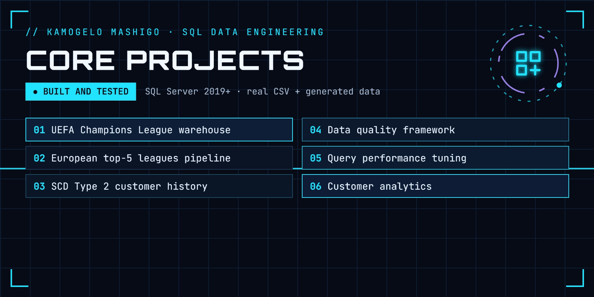

  

# Metadata-Driven Data Quality Framework

A data quality engine in SQL Server where every check is a row in a table, not a script. One procedure runs all active rules, records the share of failing rows with a PASS / WARN / FAIL / ERROR status and a JSON sample of the bad rows, and a scorecard view shows quality by table and dimension. The framework is then tested against data with 56 known defects: it must find all of them and nothing else.

**Skills shown:** rules as data, rule templates that write SQL, safe dynamic SQL with `QUOTENAME` and parameter tables, JSON samples with `FOR JSON`, quarantine with `DELETE ... OUTPUT`, fix / null-out / quarantine decisions, scorecard views, testing the tester.

<!--  -->

## How it works

| Part | File | Purpose |
|---|---|---|
| Raw zone | `raw_data/01_create_raw_sales.sql` | customers, products, orders and order items with 56 known defects of 11 kinds |
| Engine | `framework/02_create_dq_framework.sql` | `dq.rule` (one query per rule returning failing rows), `dq.usp_run_checks`, results, settings |
| Templates | `framework/03_create_rule_templates.sql` | procedures that write and register the SQL for common checks: not null, unique, accepted values, range, foreign key |
| Rules | `rules/04_register_rules.sql` | 20 rules across six dimensions: completeness, uniqueness, validity, consistency, integrity, timeliness |
| Remediation | `remediation/05_quarantine_and_fix.sql` | fix what can be worked out, null out what cannot but leaves the row useful, quarantine what cannot be trusted |
| Scorecard | `reports/07_dq_scorecard.sql` | views a dashboard can read |
| Tests | `tests/06_test_framework.sql` | tests of the framework itself |

Adding a check means adding a row to `dq.rule`. No code changes, no deployment.

<!--  -->

## Safe dynamic SQL

The engine runs stored SQL, so it is written to resist injection: identifiers are wrapped with `QUOTENAME`, and allowed-value lists live in `dq.accepted_value` and are read at run time, so a value like `O'Brien` never becomes part of the SQL text. One test registers a value containing a quote and confirms the rule still runs.

## Known defects

| Table | Defect | Count |
|---|---|---:|
| customers | duplicate `customer_id` | 4 |
| customers | NULL email | 12 |
| customers | badly formatted email | 8 |
| customers | province not in the official list | 5 |
| orders | customer that does not exist | 7 |
| orders | order date in the future | 3 |
| orders | status not accepted | 2 |
| orders | header total different from the sum of its lines | 6 |
| order_items | quantity zero or negative | 4 |
| order_items | unit price outside 1 to 50,000 | 3 |
| products | NULL category | 2 |

<!--  -->

<!--  -->

## Tests (`tests/06_test_framework.sql`)

A checker that misses problems, or reports ones that are not there, is worse than none. The tests prove: run 1 finds exactly the known defects rule by rule; run 2 (after remediation) has no ERROR-severity failures; remaining plus quarantined rows equal rows loaded; a broken rule is logged as ERROR and the run carries on; a quote in an allowed value cannot break a rule.

<!--  -->

## How to run

Open `run_all.sql` in SSMS with **Query > SQLCMD Mode** on, check `RepoPath`, and execute. The data is generated in SQL.

## Data

Synthetic, generated with arithmetic on row numbers; identical on every run.

---

[← Back to Core projects](../README.md) · [Portfolio home](../../README.md)
